# AgentLAN — LAN link for AI agents

**Proposal v0.4 · 2026-11-26**
Drafted by Claude Code. Codex CLI (0.172.0) wrote an independent proposal, then critically reviewed v0.1 and the v0.2 additions. §14 records where the two agreed, where they differed and what changed.

> **Assumptions.** "Agents" means AI coding agents such as Claude Code, Codex CLI or custom scripts. They run on Mac and Windows PCs on one LAN. The tool is vendor-neutral. Nothing is built yet; this is the design for review.

**What's new since v0.1** (v0.4 adds: hub on any PC §2.4 · AMF/1 standard message §5.3 · runner translators §7.4 · wake impact §7.5 · decisions §13)
- **Same-machine agents never touch the LAN.** The local daemon routes their messages directly (§2.2, §9.5).
- **Machine records in the registry.** Each record carries host, OS, CPU, RAM, IPs, labels and live state, and is broadcast like agent records (§3.2).
- **Protocol hardened after the Codex review:**
  - session fencing tokens;
  - a sequenced roster snapshot with ordered deltas;
  - a reconnect resync;
  - an atomic commit contract;
  - a causal loop guard;
  - a corrected Noise framing budget (§5–§8).

---

## 0. TL;DR

- **One Rust binary, `agentlan`**, runs in three roles:
  - `agentlan hub` runs on **any PC you choose** (Mac or Windows), and can move to a different PC later.
  - `agentlan node` is a background daemon on every PC.
  - `agentlan mcp` is the adapter each AI agent launches as an MCP tool server.
- **Hub and spoke across machines.** Each node makes one outbound TCP connection to the hub, encrypted and mutually authenticated with Noise. Only the hub opens an inbound port.
- **Local routing on each machine.** Agents on the same PC talk through their node over local IPC (Unix socket or named pipe). There is no TCP hop and no hub round trip, and it keeps working while the hub is down.
- **The registry records machines and agents.**
  - Every machine has a `mch_…` ID and details (host, OS, arch, CPU, RAM, IPs, labels).
  - Every agent has a permanent `agt_<ULID>` ID plus `name`, `role`, `project`, `runner` and `machine_id`.
  - The hub's SQLite database is the source of truth.
- **When an agent connects:**
  - Agents on the same PC hear about it immediately.
  - The hub announces it to every other PC.
  - The newcomer receives a sequenced snapshot of all machines and agents, with its own project first and same-machine peers flagged.
- **Messaging.** Agents can address an ID, a `name@host` handle, a role or a project. Messages are stored and forwarded, receipts are tracked, and single-recipient request/reply is supported.
- **Inbound delivery.** AI agents are turn-based, so delivery comes in tiers:
  1. pull with `inbox`/`wait_for_message` (MVP);
  2. Claude Code hooks;
  3. opt-in push or wake: Claude Channels, `codex queue`, or headless workers (§7).

---

## 1. Goals and non-goals

**Goals**
1. Run on macOS and Windows; Linux comes for free.
2. Link many agents across many PCs on one LAN.
3. Give every agent and machine a persistent recorded identity, and every agent a role and a project.
4. Broadcast identities on connect so every agent knows whom to talk to.
5. Support direct, role and project messaging, with request/reply.
6. Keep same-machine traffic local.
7. Survive restarts, sleep and flaky Wi-Fi.

**Non-goals for v1**
- WAN or NAT traversal.
- Remote command execution. Messages carry no authority (§8).
- File or blob transfer (Phase 3).
- Confidentiality from the hub operator.

**Why not use built-ins?** Claude Code's own cross-session messaging has three limits here:
- It is Claude-only.
- Cross-machine traffic relays through Anthropic's servers and needs a claude.ai sign-in.
- It has no shared role and project registry.

AgentLAN is LAN-direct, self-hosted and runner-agnostic, so Claude can talk to Codex.

---

## 2. Architecture

### 2.1 Components

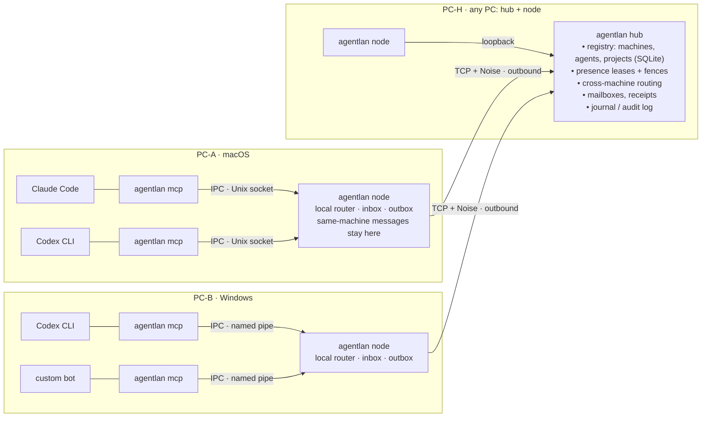

| Component | Runs where | Responsibility |
|---|---|---|
| `agentlan hub` | **Any one PC you pick**, as a **separate process** from that PC's node, so a hub crash doesn't stop local messaging there | Authoritative registry, presence leases and fencing tokens, cross-machine routing, mailboxes, receipts, rate limits, loop accounting and the journal/audit log |
| `agentlan node` | Every PC, as a per-user background service | Machine key, the single hub connection, machine details, local agent profiles, the **local router**, the durable inbox/outbox, the IPC server and the wake adapters |
| `agentlan mcp` | Launched by each AI agent (stdio) | A thin MCP server that turns tools into IPC calls. It holds no keys and opens no network sockets. |
| `agentlan` CLI/TUI | Anywhere | Setup, `doctor`, human views (`ls`, `machines`, `watch`, `tui`) and manual messages |

### 2.2 Routing paths

| Sender → recipient | Path | Touches the LAN? | Needs the hub? |
|---|---|---|---|
| Same machine | agent → IPC → **node router** → IPC → agent | **No.** Message bodies never leave the PC. | **No.** The node later exports a *metadata-only* `Journal` record (IDs, sizes, times, thread) to the hub for history and loop accounting. |
| Different machines | agent → IPC → node → **hub** → node → IPC → agent | Yes (2 hops) | Yes. If the hub is down, sends wait in the node outbox. |
| Mixed fan-out (role or project) | The node delivers its local recipients directly. The hub delivers to everyone else and **never delivers back to the origin machine.** | Only for remote recipients | Only for remote recipients |

**Why the node, not the hub, resolves local recipients.** The node is the authority on its own profiles and on which of them are attached right now. The hub is the authority on everything else. Splitting resolution this way:
- prevents double delivery;
- keeps local traffic local;
- means a PC with two or three agents works fully offline ("island mode").

**Local resolution rules.**
- **Direct mail and replies** (by ID or handle) resolve against *all* local profiles, attached or not. A detached recipient's mail waits in its local inbox, so it is never lost between the node and the hub.
- **Broadcasts** use attached profiles only.
- **`pick: one`** uses online, idle local profiles first. Once a local recipient is committed, the remote leg is skipped, so one request can never pick two recipients.

### 2.3 Topology decision

| Constraint | **Hub + node (chosen)** | Full mesh | Hybrid (hub registry, P2P data) |
|---|---|---|---|
| PCs that need an inbound firewall rule | **1** | All N | All N |
| Registry copies that must agree | **1** | N (CRDT or gossip) | 1 + N data paths |
| Correctness depends on multicast | **No** | Usually | Partly |
| Connections at 20 PCs | **20** | 190 | 20 + ad hoc |
| Single point of failure | Hub, only for *cross-machine* traffic | None | Hub, for discovery |

Every PC runs the same binary, so any PC can be the hub (§2.4).

### 2.4 Running the hub on any PC

**Pick any Mac or Windows PC.**
- Run `agentlan hub init` on the PC you choose. The hub's identity, its key and `hub.db`, lives in that PC's app data.
- On Windows, `hub init` asks once for admin rights to add the single inbound firewall rule. On macOS, it checks the Local Network permission.
- The PC only needs to be on while you want *cross-PC* messaging. Same-PC messaging never needs the hub.

**Moving the hub to another PC.**
- On the old PC, `agentlan hub move` writes a passphrase-encrypted bundle containing the hub key and `hub.db`. Before shutting down, it sends `HubMoving{new_addrs}` to every connected node.
- On the new PC, `agentlan hub import <bundle>` starts the hub.
- Nodes keep the same pinned hub key, so they reconnect on their own, using `HubMoving`, mDNS or the join-code addresses. **Nobody re-joins, and every machine and agent ID is unchanged.**
- **If the old PC died without a move,** import the latest backup. `agentlan hub backup` runs nightly and writes the encrypted bundle to a location **you choose on another device**, such as a NAS share, another PC or a USB drive. A backup that only exists on the dead PC is useless. Or start a fresh hub and run `agentlan join` on each PC again. Agent IDs are generated on the nodes and machine IDs come from each machine's own key, so all IDs survive even this.

**Two hubs up at once.**
- Nodes only talk to a hub whose key matches their pinned key. Two hubs with *different* keys are simply two separate networks.
- Every import increments a hub `epoch`. Nodes remember the highest epoch they've seen and refuse a lower one. The old PC also marks itself `moved` and refuses to start without `--force`. A stale copy of the hub therefore can't split the network.

Automatic failover between hubs stays in Phase 3.

---

## 3. Identity and the registry (core requirement)

### 3.1 Identities

| Entity | ID | Created by | Stored |
|---|---|---|---|
| **Machine** | `mch_<base32(sha256(first pubkey))[..16]>`, fixed at enrolment | `agentlan join`, which generates an X25519 static key pair | Private key in per-user app data (0600 on macOS; user-only ACL on Windows). The hub binds the *current* public key to the stable ID, so key rotation doesn't change the ID. |
| **Agent** | `agt_<ULID>`, e.g. `agt_01JDX4Q8Z6M3K9T2V7B5N1C0RA` | `agentlan agent add`, which works offline | The node's `profiles.toml` and the hub registry (authoritative) |
| **Session** | `ses_<ULID>` + `fence: u64` | Every attach. The hub issues the fence. | Hub `sessions` table |
| **Message / thread** | `msg_<ULID>` / `thr_<ULID>` | The sending node | Hub and node stores |

- **Identity is per agent**, and each agent belongs to one machine. One PC can host `backend` (Claude Code) and `reviewer` (Codex) with separate IDs.
- **Agent IDs survive** restarts, hostname changes, IP changes and runner upgrades.
- **Deleting an agent retires it.** The ID is never reused, and its history is kept.
- **Handle:** `name@alias` (e.g. `backend@studio-mbp`), unique network-wide.
  - The machine alias is chosen at `agentlan join` and defaults to the hostname. The hub keeps aliases unique.
  - Handles therefore don't break when two PCs share a hostname or one is renamed.

### 3.2 Machine record

The record has two parts with different owners:
- **Reported metadata.** The node collects it with `sysinfo` and `if-addrs` and sends it as `MachineInfo`: on connect, and whenever something changes, such as an IP change or an upgrade.
- **Hub-owned fields.** The hub derives identity, presence and agent counts from its own leases and sessions, and commits them together with the roster event that changed them. A node cannot set them.

```json
{
  "machine_id": "mch_7F3AQ2LK9XW4M8RT",          // hub-owned (stable)
  "alias": "studio-mbp",                          // hub-owned (unique, chosen at join)
  "reported": {                                   // node-reported via MachineInfo
    "hostname": "studio-mbp", "display_name": "Studio MacBook Pro",
    "os": "macos", "os_version": "15.3", "arch": "aarch64",
    "cpu": "Apple M3 Pro", "cpu_cores": 12, "ram_gb": 36,
    "addrs": [ { "iface": "en0", "ip": "192.168.1.23" } ],
    "agentlan_version": "0.1.0"
  },
  "labels": ["office", "xcode"],                  // admin-set on the hub
  "key_fp": "SHA256:Qm9v…",                       // hub-owned (current key)
  "state": "online", "agents_online": 2,          // hub-derived from leases/sessions
  "enrolled_at": "2026-11-26T09:00:00Z",
  "last_seen": "2026-11-26T10:14:40Z",
  "seq": 812                                      // hub event sequence
}
```

**Why agents care.** Machine details let an agent choose a peer by:
- **platform.** "I need a Windows build", so pick an agent on an `os=windows` machine.
- **resources.** `labels` such as `gpu` or `xcode` are set by the admin.
- **locality.** The roster marks peers on the same machine with `same_machine: true`. They share a filesystem, so absolute paths can be referenced directly. Peers on other machines need the content or a git ref instead.

**Privacy.** Hardware fields are controlled by `share_hardware = true|false`. OS usernames and MAC addresses are never sent.

### 3.3 Agent record

```json
{
  "agent_id": "agt_01JDX4Q8Z6M3K9T2V7B5N1C0RA",
  "handle": "backend@studio-mbp",
  "name": "backend",
  "machine_id": "mch_7F3AQ2LK9XW4M8RT",
  "runner": "claude-code",
  "role": "backend",
  "project": { "id": "github.com/acme/shop-api", "name": "shop-api", "branch": "feat/auth" },
  "capabilities": ["rust", "sql", "review.diff"],
  "description": "Owns the API and DB layer",
  "presence": { "state": "online", "readiness": "idle", "session_id": "ses_01JDY2…",
                "since": "2026-11-26T10:02:11Z", "note": "refactoring token refresh" },
  "first_seen": "2026-11-26T09:00:00Z",
  "seq": 815
}
```

- **`role`.** One role per profile in v1, normalised to kebab-case. `capabilities` are hints and grant **no** permissions.
- **`project.id`.** It defaults to the normalised git remote of the agent's working directory, so agents in the same repo on different PCs match automatically. `--project` overrides it.
- **`presence.state`** is one of `online` | `offline` | `lost` (missed lease) | `retired`.
- **`readiness`** is one of `idle` | `busy` | `detached`. `detached` means the node is up but the runner is not attached; mail is still accepted for that agent.

### 3.4 Where it's recorded and which copy wins

| Store | Contents | Authority |
|---|---|---|
| Hub `hub.db` (SQLite, WAL) | `machines`, `agents`, `projects`, `sessions`, `events` (an append-only log ordered by global `seq`), `messages`, `recipients`, `deliveries`, `journal` | **Source of truth** for the network-wide roster and cross-machine mail |
| Node `profiles.toml` | This PC's agent definitions | Where profile *edits* originate. Edits become an `AgentUpdate`, and the hub's accepted copy wins. |
| Node `node.db` (SQLite, WAL) | Durable inbox per local agent, outbox, same-machine messages, cached snapshot at `seq` | Authority for **which local agents are attached now** and for local mail. Otherwise a cache. |

- **One global sequence.** Every registry change (machine or agent joined, updated, left, lost or retired) is one row in `events` with a single global, monotonically increasing `seq`. Snapshots and deltas use that number (§9.3).
- **History.** `agentlan history agt_…` or `agentlan history mch_…` shows first seen, sessions, role and project changes and how each session ended.

### 3.5 Sessions, fencing and duplicates

**Fencing.**
- On `AgentUp`, the hub returns `AgentUpAck{session_id, fence}`. The fence is a per-agent counter that the hub increments.
- Every agent-scoped frame carries `(agent_id, fence)`: `Submit`, `AgentUpdate`, `AgentDown` and `Receipt`. A frame with a stale fence is rejected with `STALE_FENCE`. A late `AgentDown` from an old session can therefore never mark a new session offline.

**Duplicate attach is checked on the node.**
- Agents are bound to one machine, so a second session for the same agent can only come from that machine.
- The node rejects it with `AGENT_BUSY` (giving the existing session's age and PID) *before* any announcement, even if the hub is down.
- `--takeover` ends the old session (reason `takeover`) and starts a new one.
- **Attach and takeover are serialized per agent on the node.** Each attach gets a local session token, which the node checks on every IPC call. A replaced adapter's calls fail with `SESSION_ENDED`.
- **Attach is provisional until the hub confirms it.** The hub's `AgentUp` check covers only what the node can't know: owner machine, revoked machine, retired agent.
  - Until `AgentUpAck` arrives, the adapter reports `attached (provisional, local-only)`, and the agent can already message same-PC peers.
  - If the hub later rejects the attach, the node retracts its local `joined` event, emits a `session_rejected` event to the agent, and every further tool call returns that error.
  - A node that was disconnected learns about a retirement or revocation on its next `Resync`, and any queued sends from that agent are then rejected.
- **Agent move.** The old owner must acknowledge that the agent is quiescent (no live session, outbox drained) before the hub activates the agent on its new machine. A move started during a partition waits.

**Reconnect is not a duplicate.**
- When a machine reconnects with the same key, the hub closes the old connection before accepting traffic on the new one, which bumps the connection generation.
- The node then sends `Resync{attached: [(agent_id, session_id)], last_seq}`. The hub keeps any session still within its lease *without* a presence flap, and re-fences it.

**Hub-down rules.**
- **`Resync` sends more than live sessions.** It also carries:
  - profile metadata, including profiles created while the hub was down;
  - **session lifecycle records**: sessions that started, or started *and ended*, during the outage, with their times and end reasons.

  The hub returns an outcome for each session (`continued`, `registered`, `closed` or `rejected`) and only then announces the net changes.
- **Live mutations stay scoped to their original session.** `AgentUpdate` and `AgentDown` are never re-stamped with a newer session's fence. An update queued by an ended session is dropped, which is safe because its successor re-sends the current profile.
- **Durable traffic uses a separate replay path.** Queued `Submit`s and `Receipt`s go out after `ResyncAck` as `Replay{original session_id, …}`, authenticated by the node connection rather than a live fence. The hub keeps the original sender attribution and checks the *current* ownership, revocation and recipient eligibility. A message from a session that has since ended is still delivered.

---

## 4. Discovery and connectivity

**How a node finds the hub, in priority order:**
1. **Hard static override.** `hub = "192.168.1.50:47820"` in `node.toml` is used exclusively. Such a node does **not** follow `HubMoving`. After a hub move, update the address with `agentlan node set-hub <addr>` or remove the override.
2. **Join code and last-known addresses.**
   - `agentlan hub invite` prints `AGENTLAN1-…`. The code encodes every candidate hub address and port, the full hub public key, a one-time token and an expiry (15 minutes by default).
   - The node remembers the addresses that worked. If a candidate fails its connection or handshake, the next one is tried.
3. **mDNS / DNS-SD.**
   - The hub advertises `_agentlan._tcp.local.` with TXT `v=1` and `net=<network name>`.
   - An advertisement is only a *candidate*. The Noise handshake proves the hub key, so a copied TXT record cannot impersonate the hub. At worst it wastes a connection attempt, which is then skipped.
   - Agent and machine details never go into mDNS.

**Interface policy.**
- One policy governs both the TCP bind/advertise addresses and mDNS: primary Wi-Fi or Ethernet only. VPN, Hyper-V, WSL and Docker adapters are excluded, and `interface =` overrides the choice.
- Bindings are refreshed on address changes, and IPv6 scope IDs are preserved.

**`agentlan doctor`** reports discovery, TCP reachability, handshake and auth, and OS permission as separate checks.

**Same-machine IPC needs no network permissions.**
- **macOS:** a Unix socket inside a private 0700 per-user directory.
- **Windows:** the named pipe `\\.\pipe\agentlan-<user-SID>`. It is created with an explicit DACL for the user SID and the `PIPE_REJECT_REMOTE_CLIENTS` flag, so it can't be reached over SMB.

**Platform items to validate in the Phase 0 spike (tested on the *installed* service, not just a dev build):**
- **macOS 15 and later.** Local Network privacy applies to LaunchAgents and apps. Per Apple TN3179, tools run from Terminal or SSH and LaunchDaemons are exempt. Probe from the installed node. On failure, point to *System Settings → Privacy & Security → Local Network*.
- **Windows.**
  - The hub needs one inbound rule scoped to the binary, TCP 47820, the Private profile and the LAN subnet. The installer adds it.
  - Nodes need no listener rule.
  - mDNS (UDP 5353) and managed outbound policy can still block discovery. Test TCP and UDP independently.
- **Wi-Fi.** Multicast filtering breaks mDNS but not TCP, and client isolation breaks both. This is why join codes and static addresses come first.

---

## 5. Wire protocol (node ↔ hub)

### 5.1 Layers and limits

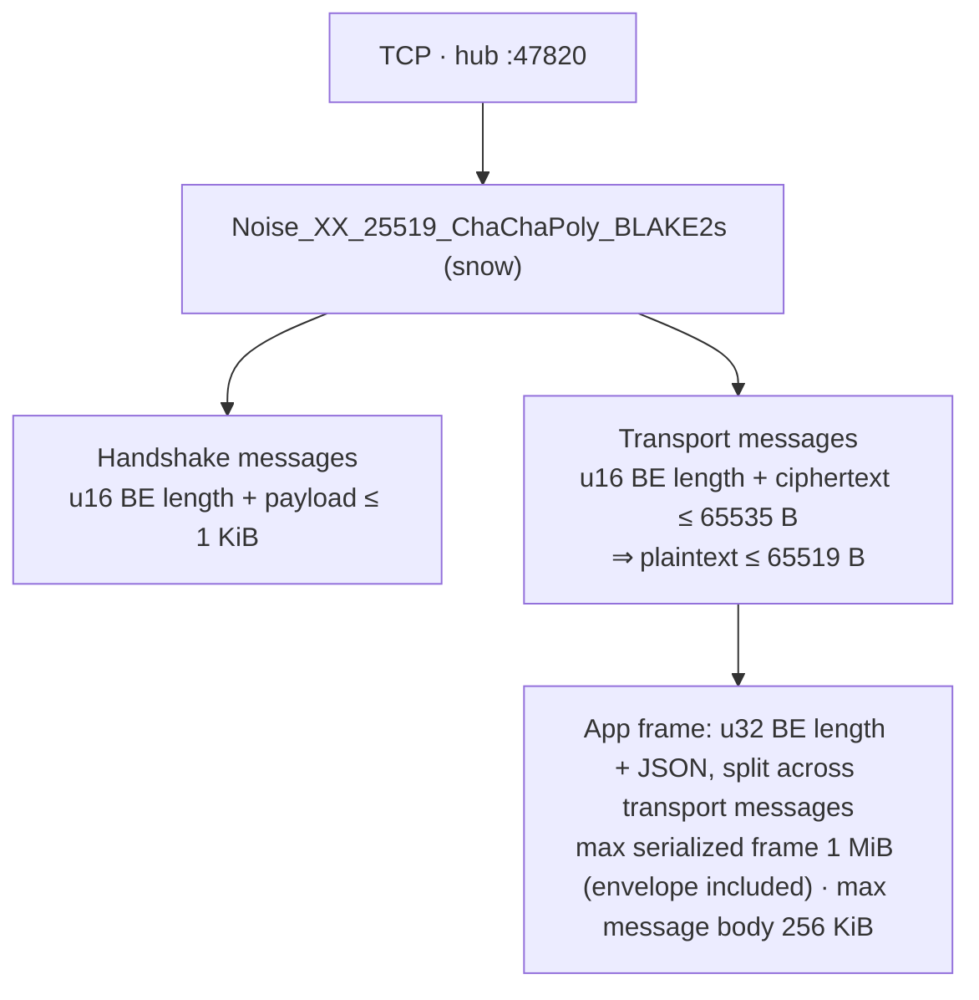

**Handshake.**
- The node is the initiator.
- After reading XX message 2, it checks the hub's static key against the pinned key from the join code *before* sending message 3. The hub checks the machine key against its enrolled list, or against the invite token on first contact.
- IK is the planned optimisation for later, because nodes already know the hub key.

**Bounds.**
- Reassembly buffers and per-connection outbound queues are bounded (1,024 frames or 8 MiB).
- A consumer that stays full for more than 10 seconds is disconnected, and its messages stay in the mailbox.
- Large snapshots are paginated (`more: true`).

**Encoding.**
- v1 uses fixed JSON.
- `Hello`/`Welcome` are always JSON. CBOR can be introduced in a later major version by having `Welcome` select it.
- Unknown optional fields are ignored, and unknown frame types return `UNSUPPORTED`.
- Protocol majors are negotiated in `Hello`/`Welcome`. If there is no overlap, the result is `INCOMPATIBLE_VERSION`.

### 5.2 Frame catalogue

| Group | Frames |
|---|---|
| Session | `Hello{protos, machine_id, app_ver}` → `Welcome{proto, hub_id, conn_gen, server_time, heartbeat_s:10, lease_s:30}` · `Enroll{token}` → `Enrolled` (consume the token and bind the key atomically; retrying with the same key is idempotent) · `Ping`/`Pong` · `Error{code,msg}` |
| Machine | `MachineInfo{reported}`: metadata only, sent on connect and on change. Identity, presence and counts are hub-owned. |
| Resync | `Resync{profiles[], attached[], lifecycle[], last_seq}` → `ResyncAck{per_session_outcome[], fences[], pauses[]}`. Pause state is restored, and only then are the outbox and journal flushed as `Replay{…}`. |
| Registry | `AgentUp{session_id, record}` → `AgentUpAck{fence}` / `Error{AGENT_BUSY}` · `AgentUpdate{agent_id, fence, changes}` · `AgentDown{agent_id, fence, reason}` |
| Roster stream | hub→node: `Snapshot{seq, machines[], agents[], more}`, then an ordered `Event{seq, kind, record}`. If a node sees a gap in `seq`, it sends `Resnapshot{from_seq}`. |
| Messaging | `Submit{agent_id, fence, envelope, local_recipients[]}` → `Accepted{msg_id, recipients}` / `Rejected{code}` · hub→node: `Deliver{recipient, pair_seq, envelope}` · `Receipt{recipient, fence?, msg_id, state}` |
| Journal | `Journal{envelope_meta, recipients[]}` → `JournalAck{msg_id}`. It records same-machine traffic as **metadata only**; bodies never leave the PC. It is idempotent by `msg_id`, and the node retains each entry until the hub acknowledges it, within a replay window of 7 days by default. |

### 5.3 The standard message: AMF/1 (AgentLAN Message Format)

AMF/1 is the **single** message format that every agent, adapter, node and hub uses. It is runner-neutral: no field in it is specific to Claude, Codex or anything else. Its `parts` use the **same shape as A2A 1.0 `Part`** (checked against a2a-protocol.org, 2026-11-26), so a future bridge to A2A agents can convert AMF messages without inventing anything.

```json
{
  "amf": "1.0",
  "id": "msg_01JDY8K3…",
  "threadId": "thr_01JDY8K2…",
  "taskId": null,
  "inReplyTo": null,
  "from": { "agent": "agt_01JDX4Q8…", "handle": "backend@studio-mbp", "role": "backend", "origin": "agent" },
  "to":   { "kind": "role", "role": "reviewer", "project": "github.com/acme/shop-api", "pick": "one" },
  "intent": "request",
  "subject": "Review token refresh",
  "parts": [
    { "text": "Please review the token refresh logic. Focus on expiry edge cases.", "mediaType": "text/markdown" },
    { "data": { "repo": "github.com/acme/shop-api", "branch": "feat/auth", "commit": "9f3c2ab" },
      "mediaType": "application/vnd.agentlan.git-ref+json" },
    { "text": "@@ -40,7 +40,9 @@ fn refresh(…", "mediaType": "text/x-diff", "filename": "src/auth.rs" }
  ],
  "replyBy": "2026-11-26T12:10:00Z",
  "createdAt": "2026-11-26T12:00:00Z",
  "expiresAt": "2026-11-27T12:00:00Z"
}
```

**Fields**
- **Naming.** Field names are camelCase to match A2A's JSON. `inReplyTo` points at the message being answered, and `replyBy` (RFC 3339) means a reply is requested by that time.
- **Routing uses the stable `agent` ID.** `handle`, `role` and `origin` inside `from` are display metadata.
- **`intent`** has a deliberately small vocabulary: `chat` · `ask` · `request` · `result` · `status` · `handoff` · `error` · `system`. `system` is reserved for broker events such as joined or left. Delivery acknowledgements belong to the transport (`Receipt`), not to a message intent.
  - Custom intents use `x-<name>`. A receiver that doesn't know one treats it as `chat`.
- **`parts`** follow the A2A rule: each part has **exactly one** of `text` | `raw` (base64) | `url` | `data`, plus optional `mediaType`, `filename` and `metadata`. AgentLAN defines a few well-known media types:

  | Media type | Payload |
  |---|---|
  | `text/markdown` | The default for `text` |
  | `text/x-<lang>` | Code |
  | `text/x-diff` | A diff |
  | `application/vnd.agentlan.git-ref+json` | `{repo, branch, commit, pr?}` |
  | `application/vnd.agentlan.file-ref+json` | `{machine, path, lines?}`. Meaningful as-is only on the same machine. |
  | `application/vnd.agentlan.task+json` | `{title, acceptance[], branch?}` |
  | `application/vnd.agentlan.status+json` | `{state: working\|blocked\|done\|failed, progress?, note?}` |

  Unknown media types are passed through untouched and rendered as `[attachment: <type> <filename> <size>]`.
- **Trusted fields.** `from` (including `origin`: `agent` | `human` | `system`) is stamped by the first trusted hop: the node for local traffic, the hub for cross-machine traffic. Client-supplied values are ignored.
- **`to.kind`** is one of `agent` | `handle` | `role` (+ project, `pick: all|one`) | `project` | `machine` | `all` (admin only).

**Rules**
1. **Plain-text floor.** Every message must have a `subject` or at least one `text` part. The node rejects a message with no text-renderable content. Any agent can therefore read any message with no translator at all.
2. **No runner-specific fields** in AMF, the protocol or the hub. Runner differences live only in edge adapters (§7.4).
3. **Structure adds no authority.** A `task` or `request` from a peer is untrusted data, exactly like free text.
4. **Versioning.** `amf: "1.x"` changes are additive only, and unknown fields and parts are preserved. Breaking changes require `"2.0"`.
5. **Limits.** At most 256 KiB across all parts, and `raw` parts at most 64 KiB in v1. Larger content goes through a `url` part, a git ref, or blob transfer in Phase 3.
6. **Published schema.** `amf-1.schema.json` (JSON Schema) is generated from the Rust types with `schemars`, so non-Rust agents can validate their messages.

**Mapping to A2A 1.0**

| AMF | A2A |
|---|---|
| `id` | `messageId` |
| `threadId` | `contextId` |
| `taskId` | `taskId` |
| `parts` | `parts` (identical shape) |
| `from.origin` | `role`: `agent` → `ROLE_AGENT`, `human` → `ROLE_USER` |
| `from`, `to`, `intent`, `subject`, `inReplyTo`, `replyBy` | carried in `metadata` under an `agentlan/1` extension |

---

## 6. Routing and delivery semantics

**Resolution.**
- The origin node resolves local recipients from its attached set. The hub resolves remote recipients and never delivers back to the origin machine.
- `role` + `pick: one` chooses one online, idle match. A local match is preferred, because it is cheaper and shares the filesystem.
- Zero matches returns `Accepted{recipients: 0}` rather than an error.

**Commit before accept.** For *every* route, the store that accepts the message commits atomically before returning `Accepted`. That store is the node for local recipients and the hub for remote ones.

- **The node commits one transaction** containing:
  - the message;
  - the frozen *local* recipient set and their inbox rows;
  - the dedup record;
  - the loop-budget debits;
  - the deferred work: the `Journal` entry and, for remote or mixed sends, the outbox `Submit`.

  A crash can therefore never leave local delivery done but the remote leg or journal forgotten.
- **The hub commits** the message, the frozen *remote* recipient set, the dedup record and the pair-budget debits.
- **Retries return the original committed result.**

**SQLite configuration.**
- Writes go through one dedicated writer thread with a bounded queue, outside Tokio's async workers.
- WAL mode with `synchronous=FULL`. Messages are small and volume is low, so power-loss durability is affordable.

**Delivery and inbox.**
- The hub delivers to a recipient's **node** whenever that node is connected, even if the runner is detached. The node inbox is the agent's durable mailbox.
- Each (sender, recipient) pair has a persistent `pair_seq` for FIFO order.
- Delivery is deduplicated by `(recipient, msg_id)`.
- The hub replays until it receives a `Receipt{stored}`.

**Message states.**

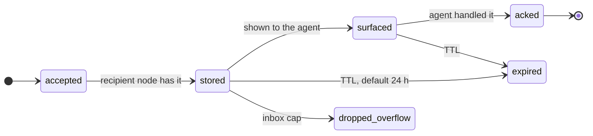

`surfaced` does **not** hide a message. `inbox()` defaults to all *un-acked* messages, unseen ones first, so a tool result lost in transit never loses mail.

**Broadcasts.**
- Role and project fan-out goes only to agents eligible at commit time. Late joiners don't get old broadcasts. Phase 3 may add sticky notices.
- **Local eligibility** is fixed when the node commits. **Remote eligibility** is fixed when the hub *first* accepts an unexpired submission, so a send that waited in the outbox reaches whoever is online when it is flushed.
- Both sets are frozen, so retries never re-resolve.
- **The fan-out cap** is enforced against real counts: the frozen local count at the node, and the authoritative remote count at the hub, which must be no more than the cap minus the local count. The cached roster is used only for previews.
- The final outcome is visible through `message_status`.

**Request/reply.** v1 requests are single-recipient: `agent`, `handle` or `role` + `pick: one`. Three separate timers apply:
- **`waitS`.** How long `request()` blocks. It is capped at 45 seconds, below Codex's default MCP tool timeout. Codex's review gives that default as 60 seconds; validate it in Phase 0. If no reply arrives in time, it returns `PENDING{msg_id}`, and the agent can call `wait_for_message(thread=…)`.
- **`deliver_by`.** An undelivered request expires and the sender is notified.
- **Reply retention.** This is the normal message TTL. Late replies always land in the inbox.

The reply target and thread are derived from the *stored* request, not from client input.

---

## 7. Agent integration and inbound delivery

### 7.1 Attaching

```bash
# Claude Code (local scope = this project only)
claude mcp add -s local agentlan -- agentlan mcp --agent backend
# Codex CLI (MCP config is user-wide, so let the adapter pick the profile)
codex mcp add agentlan -- agentlan mcp --agent auto --runner codex
```

- `--agent auto` picks the profile whose `runner` matches and whose `project` matches the git remote of the working directory. It therefore only works for profiles with a fixed `--project`. Profiles that auto-detect their project need an explicit `--agent`.
- If no profile matches, or more than one does, tools return an explicit error ("run `agentlan agent add …`" or "ambiguous: pass --agent"). A profile is never created silently.
- **The adapter initialises from local node state** and never blocks on the hub. While the hub is offline, tools still work for local peers and show `hub: offline`.
- Phase 0 must confirm what working directory each runner gives stdio servers. MCP roots are optional, so the adapter can't rely on them.

### 7.2 MCP tools

| Tool | Purpose |
|---|---|
| `whoami` | My ID, handle, role, project, machine and hub state |
| `list_agents(project?, role?, state?, capability?, machine?)` | The roster: my project first, `same_machine` flagged |
| `list_machines()` | Machines with OS, arch, CPU, RAM, labels, state and agent count |
| `send({to, intent?, subject?, text \| parts, inReplyTo?, replyBy?})` | Send an AMF/1 message: direct, role, project or machine. `text` alone is enough. Returns `{id, threadId}`. |
| `request({to, text \| parts, waitS≤45})` | Single-recipient request that returns the reply or `PENDING{id}` |
| `reply({messageId, text \| parts})` | Reply. The target, thread and `inReplyTo` come from the stored message. |
| `inbox(limit?, messageId?)` | Un-acked messages, unseen first, or one message by ID (the target of a wake pointer) |
| `wait_for_message(timeout_s≤45, from?, thread?)` | Cancellable long-poll, kept below the host's tool timeout |
| `ack({messageId, note?})` | Mark a message handled. This is a transport receipt, not a message. |
| `message_status({messageId})` | Delivery state per recipient |
| `set_status(readiness, note?)` | Readiness `idle`/`busy` plus a "working on" note |

**Every tool result carries an unread summary.** Text adapters append a footer, e.g. `📬 2 unread — reviewer@win-pc (request), qa@studio-mbp (same machine)`. JSON adapters such as Codex get the same summary as `unread` in `structuredContent`, so it reaches every runner.

### 7.3 Getting a message to an agent that isn't listening

| Tier | Mechanism | Runner | Status and guarantees |
|---|---|---|---|
| **0. Pull (MVP, default)** | `inbox` / `wait_for_message`, the unread footer, `agentlan watch` for humans | All | Plain MCP, works everywhere |
| **1. Passive hooks** | **SessionStart:** inject whoami, roster and unread. **UserPromptSubmit:** inject unread. **PostToolUse** `additionalContext`: "📬 N new". Hooks call `agentlan hook claude <event>`. | Claude Code | Documented hook features. They only *show* mail while the agent is already working; they never make it do extra work. They inject **pointers** (count, sender handle, intent, message ID), never bodies. |
| **1+. Stop-hook continuation** | **Stop:** `{"decision":"block","reason":"<pointer>"}` when unread messages exist. The reason is the same locally generated pointer as the wake text (§7.4), never message bodies. | Claude Code | **This makes an agent work because a peer wrote**, so it is treated like tier 2: opt-in, with the §7.5 policy. It only *extends the current turn*. Claude's consecutive-block counter resets on tool calls, so AgentLAN enforces its own continuation budget per session. |
| **2a. Push** | **Claude Code Channels.** `agentlan mcp` declares `claude/channel` and emits `notifications/claude/channel`, which the model sees as `<channel source="agentlan" …>`. | Claude Code | **Research preview.** Needs `--dangerously-load-development-channels server:agentlan`, an interactive session and claude.ai/Console auth. Channels are not registered when the server negotiates MCP revision 2026-07-28, so pin the legacy negotiation. Channel delivery has no processing acknowledgement, so messages stay pending until the agent calls `ack`. |
| **2b. Wake** | `codex queue --thread <id> --message <text> --resume` | Codex CLI | **Best effort.** Per Codex's review of the 0.172.0 source, it can report success even when the resume fails. The profile must be bound to a verified Codex thread ID. Track queued and processed separately; pull remains the fallback. |
| **2c. Headless workers** | The node supervises a long-lived worker. Claude uses the Agent SDK streaming input (`SDKUserMessage` queue) or `claude -p --resume`. Codex uses `codex exec resume <id> "<msg>"`. | Both | For unattended service agents, e.g. a reviewer bot |

All work-starting options (1+ and tier 2) are opt-in per profile, rate-limited and subject to the loop guard. They all sit behind one `WakeAdapter` trait.

### 7.4 Translators: runner adapters at the edge

Translation happens **only** in `agentlan mcp`, in the CLI and in the node's wake adapters. The hub and the wire carry AMF unchanged.

| Direction | What the adapter does |
|---|---|
| **Inbound (AMF → model)** | Every MCP tool result returns **both** forms: `structuredContent: {messages:[AMF…], nextCursor?, trust:"untrusted-peer"}` **and** a `content` text block. A runner that ignores structured content still gets complete text (the plain-text floor). |
| **Outbound (model → AMF)** | The MCP tool schemas *are* the standard: `send({to, intent, subject?, text \| parts, inReplyTo?, replyBy?})`, with **exactly one** of `text` or `parts`. No free text is parsed. A plain `text` becomes `[{text}]`. The node stamps `id`, `from`, `createdAt` and `amf`, and returns `{id, threadId}`. Adapters only fill defaults, such as a git ref from the working directory when `attachGit: true`. |
| **Wake text** | The text used by Stop hooks, Channels and `codex queue` is **generated locally and contains no peer-written words**, not even the subject. Example: `New agentlan request msg_01JE… from reviewer@win-pc. Call agentlan.inbox with messageId=msg_01JE….` The sender handle is stamped by the hub and the intent is an enum, so both are safe to include. The body is only ever read through the tool. The reason: `codex queue` submits *user* input, so a peer-written subject there would read as an instruction from the user. |
| **Viewer context** | A `file-ref` from another machine is rendered as "file on studio-mbp: src/auth.rs:40-120 (not on your machine; ask for the content or use the git ref)". Timestamps are shown in local time, and same-machine peers are flagged. |

**Adapters in v1**

| Adapter | Rendered inbound text |
|---|---|
| `claude-code` | Wrapped in `<agentlan_message from="…" role="…" intent="…" same_machine="…" untrusted="true">…</agentlan_message>`, with Markdown parts inside |
| `codex` | **JSON, with no wrapper.** The `content` text is the same JSON as `structuredContent`. Codex's own guidance: Codex CLI 0.172.0 forwards `structuredContent` as JSON text when both are present. Beside the AMF objects (never inside them), `structuredContent` also carries `unread` (the summary that text adapters print as a footer) and `views[msgId]`, which holds per-viewer hints such as `sameMachine` and, for each file reference, whether it is on your machine. The `trust` field carries the untrusted status. |
| `generic` | Markdown: a header block (from, role, intent, subject, thread), then each part, with code and diffs fenced |

**Non-MCP agents and scripts** use the CLI with AMF JSON in and out:
- `agentlan send --json -` (AMF on stdin);
- `agentlan inbox --json`;
- `agentlan watch --json` (JSON lines);
- `agentlan agent attach <profile> --json`, which holds a session open while the script runs.

The local IPC protocol (JSON lines) is documented too.

**Agnostic test, a Phase 1 exit criterion:** a plain shell script using only the CLI can attach, be announced, send and receive.

In Rust, each adapter implements one trait:

```rust
trait RunnerAdapter {
    fn id(&self) -> &'static str;                                   // "claude-code" | "codex" | "generic"
    fn render(&self, msg: &Amf, ctx: &ViewCtx) -> Rendered;          // text for `content`
    fn wake_text(&self, msg: &Amf, ctx: &ViewCtx) -> String;         // short pointer
    fn outbound_defaults(&self, draft: &mut AmfDraft, ctx: &ViewCtx);
}
```

### 7.5 Impact of starting work in another agent's session

"Wake" means a message makes another agent take a turn without a human prompting it: Stop-hook continuation, Channels, `codex queue`, or a headless worker.

| Impact | What actually happens | Mitigation |
|---|---|---|
| **Usage and cost** | Each woken turn is a full model turn and counts toward that runner's usage like a typed prompt; Claude Code's own docs say this for its cross-session messages. Chains multiply: A wakes B, B replies and wakes A, and so on. | Wake only on `request`/`handoff` intents, never on `chat`/`status`. Turn budgets per profile per hour. The loop guard (§8). |
| **It acts with *that* session's permissions on *that* PC** | A woken agent can run commands and edit files within whatever its permission mode allows. If that session auto-approves everything, a peer's message effectively becomes remote code execution on that PC. | **Never wake a session that auto-approves.** This mirrors Claude Code's own rule, which holds cross-session messages for approval when the receiver bypasses permissions. Woken turns run in a restricted permission mode. |
| **Prompt injection spreads** | One misled agent can pass injected text to the next, and with wake there is no human in between. | Messages stay untrusted data. An allowlist controls who may wake whom. **Wake depth ≤ 2:** a turn that was itself woken can wake at most one further level. |
| **It can hijack your session** | If you are using a Claude or Codex window, an injected message redirects it mid-task, or keeps it working on a peer's request after you thought it had finished. Its context fills with other agents' traffic. | By default, never wake a session a human is using. Wake requests for interactive sessions go to an approval prompt (`agentlan watch` / desktop notification). |
| **Edit conflicts** | Two agents in the same working tree or branch can overwrite each other's files and break builds. | One git worktree and branch per agent profile, and the `task` part carries the branch. Advisory path locks in Phase 3. |
| **Reliability** | Claude Channels is a research preview and `codex queue --resume` is best effort, so wakes can fail silently or change behaviour after a runner upgrade. | Queued and processed states are tracked separately, pull remains the fallback, and Phase 0 tests each adapter. |
| **Accountability** | It becomes hard to tell why an agent did something. | The journal links every woken turn to the message that caused it. |

**Recommendation:**
- **Default off.** Agents see messages while they're working (footer, passive hooks) or when you prompt them.
- **Allow wake only for *worker profiles*.** These are sessions you start specifically to be driven by other agents: headless, with their own worktree, restricted permissions and a turn budget.
- **Interactive sessions get an approval prompt** instead of an automatic wake.

---

## 8. Security and agent safety

**Network trust.**
- **Enrolment.** A one-time invite token runs over the authenticated Noise session. The hub consumes the token and binds the machine key in a single transaction, and retrying with the same key is idempotent. Unknown keys are rejected after that.
- **Revocation and rotation.**
  - `agentlan hub revoke <machine>` closes live connections and denies new ones.
  - `agentlan node rotate-key` presents the new key over a session authenticated with the old one.
- **Admin rights** live on the hub as a list of admin machines. Agent moves (`agentlan agent move`) and retirement are hub transactions: they fence the old owner and either move its mailbox or expire it.
- **Replay.** Noise nonces protect within a session, and `msg_id` dedup protects across reconnects.

**Local trust.**
- The IPC endpoint is restricted to the current OS user: a private directory on macOS; the SID DACL with `PIPE_REJECT_REMOTE_CLIENTS` on Windows.
- Any process running as that user can act as that user's agents. This is the same boundary the agents already have.

**Agent safety.** This matters more than crypto here.
1. **Messages are untrusted data, never instructions.** Every adapter marks peer content as untrusted, with trusted metadata kept outside the body:
   - the Claude Code adapter wraps it as `<agentlan_message from="…" untrusted="true">…</agentlan_message>`;
   - the Codex adapter sets `trust: "untrusted-peer"` beside the AMF objects in `structuredContent`;
   - the generic adapter prints an explicit untrusted header.

   Wake text and hook text carry pointers only. The tool descriptions say that peer messages are requests to evaluate, not commands.
2. **The protocol has no verb** for execute, approve, config or file write. Messages cannot bypass runner permission prompts. Automated turns (tier 2) should run with restrictive runner permissions.
3. **Rate limits**, enforced identically by the node for local traffic and the hub for remote traffic:
   - 20 messages per minute per sender;
   - a fan-out cap of 10 for non-admins;
   - 256 KiB per body;
   - capped inboxes.
4. **Causal loop guard.**
   - **Causal parent.** Every agent-originated message has a causal parent, recorded by the node as `causedBy` in the journal. A `reply` uses its `inReplyTo`. Otherwise it is the most recent message surfaced to that agent in the same thread, and a message that is not in a thread starts a new one.
   - **The sender's node enforces synchronously.** Every send passes through it, local or not.
     - It counts *automated* messages per agent per hour, per thread, and per **local** pair.
     - Budget debits are persisted in the same transaction as acceptance, so a restart doesn't reset them.
     - When a budget is exceeded, the node refuses the send with `PAUSED`.
     - Two agents on one PC are the fastest possible loop, so this works with the hub down.
   - **The hub enforces network-wide totals.**
     - **Remote pair budgets** are charged when the hub commits, because only then are remote recipients known.
     - **Thread totals** span machines and are enforced synchronously on each remote commit.
     - **Counting rules:** each logical send counts once per thread, and each committed pair once, using stable `msg_id`s across retries. A mixed send's `Submit` and `Journal` therefore never double-count.
     - **After an island period,** journals reconcile local usage on reconnect. A thread that went over budget offline is paused then.
     - **Pause state is persisted on the nodes** and restored *before* any queued sends are flushed.
   - Resuming needs `agentlan thread resume` with **interactive TTY confirmation** on a machine marked admin. CLI sends do *not* reset budgets, because an agent can run the CLI too.
   - Agents run as the same OS user, so this is a cost and safety brake, not a hard security boundary.
5. **Audit.** The hub journal always records metadata. For messages routed through the hub, bodies are recorded only with `audit.bodies = true`. Bodies of same-machine messages never leave the PC; the node keeps its own local log. Everything expires with the message TTL.

---

## 9. Process flows

### 9.0 Overview

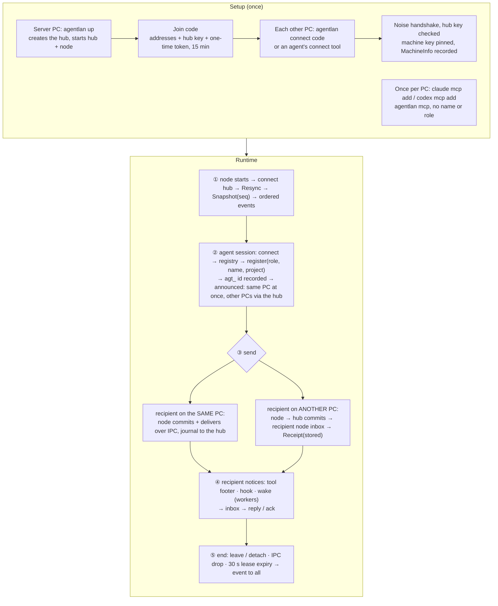

### 9.1 First-time setup and enrolment

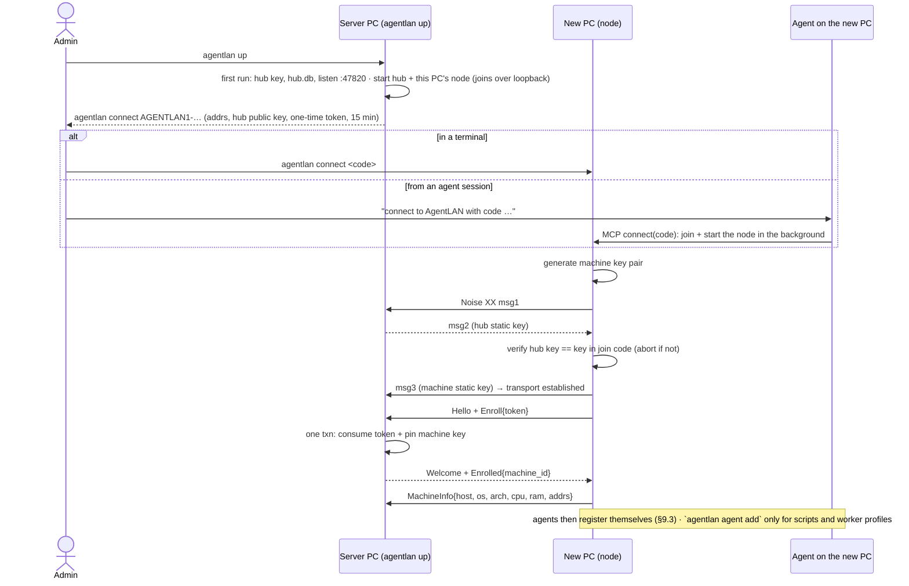

### 9.2 Node start-up and reconnect

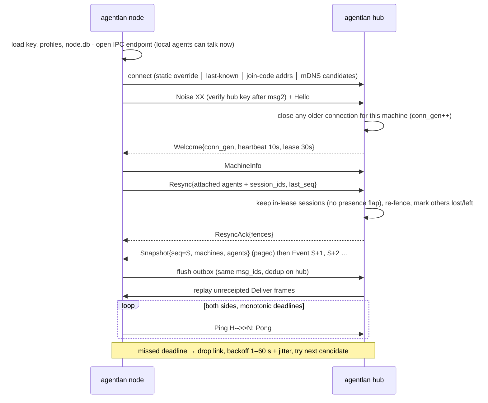

### 9.3 Agent connects and announces (core requirement)

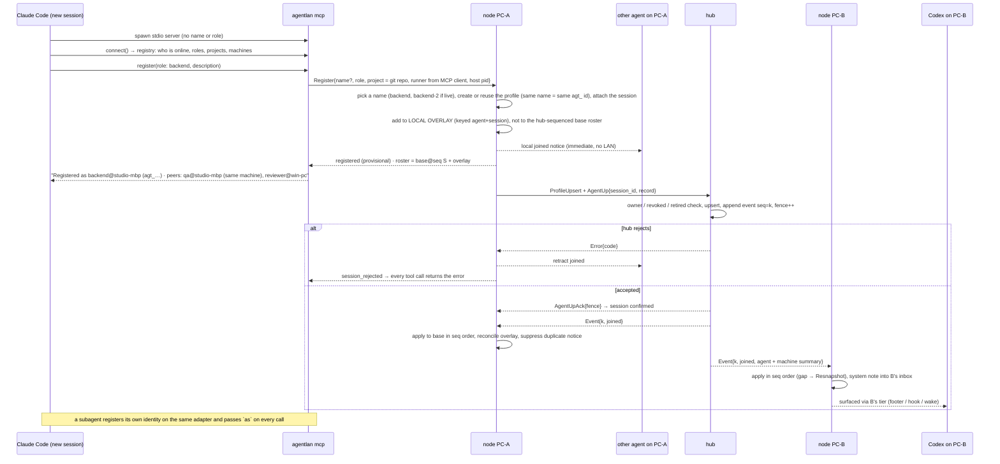

**Roster bookkeeping on a node.**
- The node keeps a **base roster**, which changes only through hub events applied in `seq` order, and a **local overlay** of its own live sessions.
- After a resnapshot, the overlay is rebuilt from live IPC sessions.
- While the hub link is down, cached *remote* presence is marked `stale` in `list_agents`.

### 9.4 Cross-machine direct message

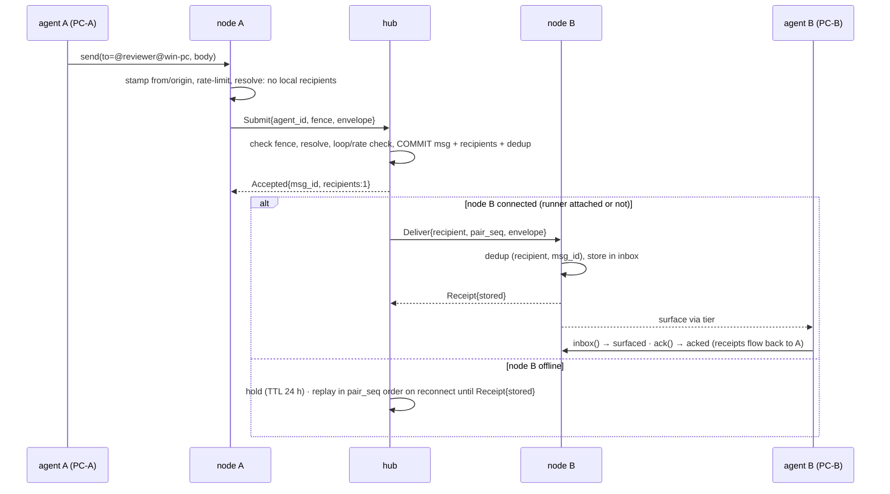

### 9.5 Same-machine message (no LAN)

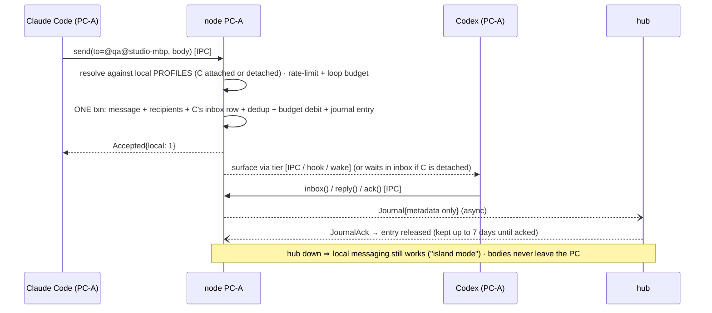

### 9.6 Role / project fan-out (mixed local + remote)

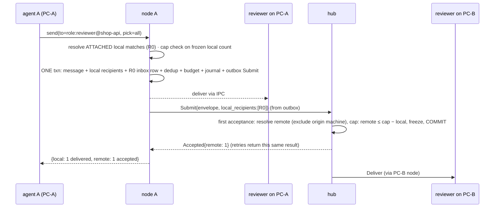

The sender always gets **separate local and remote results**:
- **Local:** a delivered count.
- **Remote:** one of:
  - `accepted{n}`;
  - `rejected{code}`;
  - `queued`, if the hub is offline. The remote recipients are then resolved and frozen when the hub first accepts the outbox entry.

The final outcome is available via `message_status`. Local delivery is never rolled back if the remote part fails. With `pick: one`, a committed local match skips the remote leg entirely.

### 9.7 Request and reply

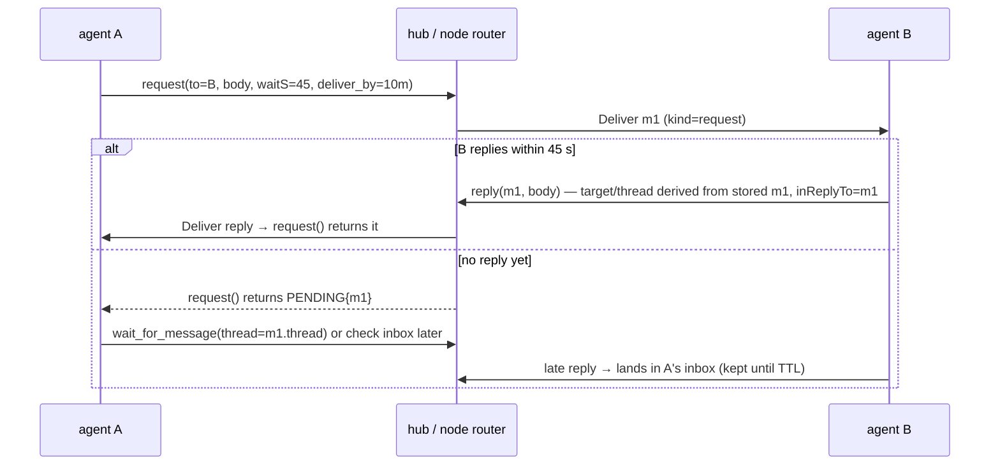

### 9.8 Leave, crash and hub loss

| Event | Detected by | Latency | Announced as |
|---|---|---|---|
| Agent exits cleanly | The adapter sends `Detach` before closing | Immediate | `left` |
| Runner or adapter crashes | The node sees the IPC drop with no `Detach` | Immediate | `left (detached)`; mail still accepted |
| PC sleeps, node dies or the link blackholes | Hub heartbeat deadline missed (lease 30 s) | ≤ 30 s | `lost` for that machine and all of its agents |
| Short network blip | The node reconnects within the lease and sends `Resync` | — | **Nothing.** The session continues and is re-fenced. |
| Hub down | Nodes miss their deadline | ≤ 30 s | Nodes show `hub: offline`. Local messaging continues; remote sends queue in the outbox. |
| Hub restart | Registry and mailboxes reload from `hub.db`. Sessions are `lost` until resync. | — | Restored via `Resync` |

Recorded end reasons are distinct: `left` | `detached` | `lease_expired` | `takeover` | `hub_restart` | `retired`.

### 9.9 Worker wake over ACP (implemented in v0.2.0-beta.2)

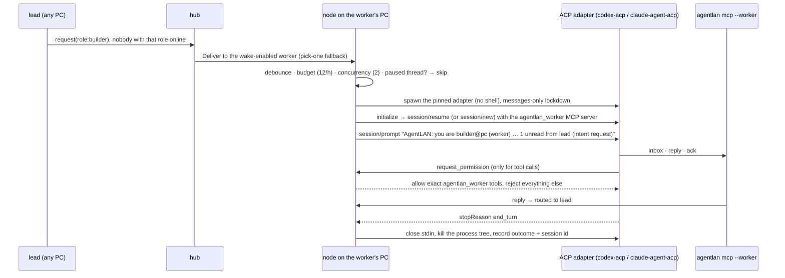

---

## 10. Rust implementation

### 10.1 Workspace

```
agentlan/
├─ Cargo.toml                  # [workspace]
├─ crates/
│  ├─ agentlan-proto/            # IDs, MachineRecord, AgentRecord, Envelope, frames, errors (no I/O)
│  ├─ agentlan-policy/           # target resolution, rate limits, loop guard — shared by hub AND node router
│  ├─ agentlan-net/              # Noise handshake, chunked framing, bounded queues, mDNS, interface policy
│  ├─ agentlan-store/            # SQLite schemas/migrations, single-writer thread, queries
│  ├─ agentlan-hub/              # registry + events/seq, leases/fences, cross-machine routing, journal
│  ├─ agentlan-node/             # hub link, resync, local router, IPC server, machine info, wake adapters
│  ├─ agentlan-mcp/              # rmcp stdio server → IPC; optional claude/channel push
│  └─ agentlan/                  # single binary: clap CLI, TUI, service install, doctor, hooks
└─ tests/                      # in-process multi-node tests: hub + N nodes, partitions, reconnects
```

### 10.2 Crates (versions checked with `cargo info`, 2026-11-26)

| Need | Crate | Version |
|---|---|---|
| Async runtime / framing | `tokio`, `tokio-util` | 1.54, 0.7 |
| Noise | `snow` | 0.10 |
| mDNS / DNS-SD (pure Rust) | `mdns-sd` | 0.22 |
| Interfaces, sockets | `if-addrs`, `socket2` | 0.15, 0.6 |
| Machine details | `sysinfo` | 0.40 |
| Local IPC (Unix sockets / named pipes) | `interprocess` | 2.4 |
| MCP server | `rmcp` | 3.11 |
| Storage | `rusqlite` (`bundled`) | 0.43 |
| Serialisation, IDs, paths, schema | `serde`/`serde_json`, `ulid`, `directories`, `schemars` (AMF JSON Schema) | 1.x, 3.0, 6.0, 1.2 |
| CLI / TUI | `clap`, `ratatui` | 4.6, 0.30 |
| Logging | `tracing` | 0.1 |
| Windows service (hub) | `windows-service` | 0.8 |

Phase 0 should check whether `interprocess` exposes the custom pipe DACL and `PIPE_REJECT_REMOTE_CLIENTS`. If it doesn't, use `windows-sys` directly for pipe creation.

### 10.3 Platform specifics

| | macOS | Windows |
|---|---|---|
| Node service | `~/Library/LaunchAgents/dev.agentlan.node.plist` (per user) | Task Scheduler "at logon" task |
| Hub service | LaunchAgent, or a LaunchDaemon for a headless box | Windows Service or logon task |
| IPC | Unix socket in a private 0700 dir | `\\.\pipe\agentlan-<SID>`, SID DACL, reject remote clients |
| Keys / config | Per-user app data, 0600 | `%APPDATA%`, user-only ACL |
| Packaging | Signed and notarised | Signed `.exe`, later MSI or winget |

### 10.4 CLI sketch

```bash
agentlan hub init --name home-lab && agentlan service install --hub && agentlan hub invite
agentlan join AGENTLAN1-… && agentlan service install
agentlan agent add backend  --role backend  --runner claude-code
agentlan agent add reviewer --role reviewer --runner codex --project github.com/acme/shop-api
agentlan machines                      # PCs with OS / CPU / RAM / labels / state
agentlan ls --project shop-api         # agents, roles, readiness, same-machine flag
agentlan send @reviewer@win-pc "PR 12 is ready"
agentlan watch | agentlan tui | agentlan doctor | agentlan history agt_…
```

---

## 11. Phased plan

| Phase | Scope | Exit criteria |
|---|---|---|
| **0. Spikes** | Exercised on the **installed** services:<br>• Noise over TCP between Mac and Windows<br>• Windows firewall (hub rule, no node rule, UDP 5353)<br>• macOS Local Network for a LaunchAgent and a signed binary<br>• `mdns-sd` on the real Wi-Fi<br>• named-pipe DACL and remote-reject<br>• the working directory runners give stdio servers<br>• the Codex tool timeout<br>• one Claude hook and a Channels prototype<br>• `codex queue --resume` on loaded and unloaded threads | A written go/no-go per item; the design is updated |
| **1. Core MVP** | • Hub and node, join codes, static address<br>• machine and agent registry with `seq` snapshots and deltas<br>• fencing, resync, leases<br>• **same-machine router**<br>• cross-machine direct messages with an atomic commit, receipts and outbox<br>• **minimal `agentlan mcp`**: `whoami`, `list_agents`, `list_machines`, `send`, `inbox`, `wait_for_message`, `ack`<br>• CLI | A Mac and a Windows agent exchange messages. Same-machine messages work with the hub down. **A plain shell script using only the CLI (AMF JSON) can attach, be announced, send and receive.** Clean recovery from restart, sleep and duplicate retries. |
| **2. Agent loop** | • Role and project fan-out, `pick: one`<br>• request/reply<br>• rate limits and the causal loop guard<br>• mDNS<br>• Claude hooks (tier 1)<br>• Codex wake (tier 2b, opt-in)<br>• TUI | A Claude agent and a Codex agent on different PCs finish a review round trip with no human relay. Load test with 20 simulated nodes. |
| **3. Hardening** | • Claude Channels (when stable)<br>• headless worker supervisor<br>• installers and signing<br>• standby hub<br>• sticky notices<br>• blob transfer<br>• web dashboard | Driven by real usage |

---

## 12. Risks

| Risk | Mitigation |
|---|---|
| Runners are turn-based, so mail sits unread | Tiered delivery, the unread footer, `wait_for_message`, and pull always available |
| Vendor push and wake features change (Channels is a preview; `codex queue` is best effort) | One `WakeAdapter` trait, opt-in, with tiers 0 and 1 as the floor |
| Prompt injection or agent loops (cost) | Untrusted wrapping, no authority verbs, rate limits, the causal loop guard, TTY-confirmed resume, restrictive permissions for automated turns |
| macOS Local Network, Windows firewall, multicast filtering | Join codes and a static address first, `doctor`, installer rules, a Phase 0 test on the installed service |
| Multiple NICs (VPN, WSL, Hyper-V, Docker) | One interface policy for TCP and mDNS, an override, and all candidates in the join code |
| Hub is a single point of failure | Same-machine traffic unaffected, outbox and replay, persistent store, standby hub in Phase 3 |
| SQLite contention | Single writer thread, WAL, bounded queues; volume is low (2–20 PCs) |

---

## 13. Decisions

| # | Topic | Decision (2026-11-26) |
|---|---|---|
| 1 | Hub placement | **Any PC you choose**, Mac or Windows. It can be moved later with `agentlan hub move` / `import` without re-joining (§2.4). |
| 2 | Runners | **Agent-agnostic.** One standard message format, AMF/1, with an A2A-compatible part shape. Thin translators sit only at the edge: Claude Code, Codex and a generic CLI/JSON adapter (§5.3, §7.4). |
| 3 | Auto-wake | **Decided:** off by default. Only dedicated **worker** profiles can be woken; they get their own worktree, restricted permissions and a turn budget. Interactive sessions get an **approval prompt** instead. The impact analysis is in §7.5. |
| 4 | Machine details | **Shared by default** (recommendation adopted). OS and version, arch, CPU model and cores, RAM, LAN IPs and labels are broadcast because it is your own trusted LAN and they help agents choose peers. Turn it off per PC with `share_hardware = false` in `node.toml`. OS usernames, MAC addresses and serial numbers are never sent. |
| 5 | Name | **`agentlan`** (renamed from the working name "ailink" on 2026-11-26). Checks: free on crates.io and npm; `agentlan.dev` and `agentlan.io` unregistered; no trademark or product conflicts found in web search; direct USPTO search still to do. Rejected: **ailink** (crowded brand: AI-LINK, AI-Link, the AILinkX agent-messaging project); **squadlink** (USPTO 99442562 SQUADLINK, class 042 SaaS, Notice of Allowance 2026-09-08; `.com`/`.dev`/`.org` taken); **squadwire** (one letter from Squadware Inc. software marks); **patchcord**, **crosswire**, **agentyard**, **roundtable** (existing agent-messaging packages). |

---

## 14. Claude ↔ Codex reconciliation

**Round 1: independent proposals**

| Topic | Claude | Codex | Decision |
|---|---|---|---|
| Topology | Hub + node per PC | Broker + daemon per PC | Agreed |
| Discovery | mDNS + UDP beacon + static | Static first, mDNS only | **Codex.** The beacon was dropped; join codes were added. |
| Encoding | CBOR | JSON | **Codex.** Fixed JSON in v1. |
| Transport security | Noise XX, pinned keys, join code | mTLS with a private CA | **Noise.** See the round 2 note. |
| Key granularity | Per machine | Per agent profile | **Per machine.** Agents are bound to their machine; moves are hub transactions. |
| IDs | ULID | UUIDv4 | ULID |
| Roles | Several | One + capabilities | **Codex** |
| Session IDs; `idle`/`busy`/`detached` | — | Proposed | Adopted |

**Round 2: Codex's review of v0.1, and what changed**

| Codex finding | Change in v0.2 |
|---|---|
| The wire couldn't enforce session fencing | `AgentUpAck{fence}` on every agent-scoped frame; atomic takeover; connection generations (§3.5, §5.2) |
| Roster snapshots could race announcements | A global `seq`, snapshot then ordered deltas, `Resnapshot` on gaps, same-node fan-out (§3.4, §9.3) |
| Reconnect could hit `AGENT_BUSY` against its own lease | `Resync` with in-lease continuation; outbox flushed only after `ResyncAck`; distinct end reasons (§9.2, §9.8) |
| No complete commit contract for `Accepted` | Message + frozen recipients + dedup committed atomically on every route; single writer; WAL with `synchronous=FULL` (§6) |
| Receipt loss could break FIFO or hide mail | Deliver to the node even when detached; `pair_seq`; dedup by `(recipient, msg_id)`; `surfaced` ≠ hidden; terminal states (§6) |
| Noise rationale conflated transport with key granularity | Verify the hub key after msg2; IK later; key rotation and revocation defined. **Noise is kept** for no-PKI operation and a smaller dependency surface. Per-machine mTLS is an equally valid swap inside `agentlan-net`. |
| Framing underspecified (65,519-byte plaintext; 1 MiB body > 1 MiB frame) | Separate handshake and transport limits; the cap applies to serialized frames; 256 KiB body; bounded queues; paged snapshots; codec negotiation deferred (§5.1) |
| Late replies were both rejected and promised | Three timers (`waitS`, `deliver_by`, retention); single-recipient requests; `PENDING`; target derived from the stored request (§6, §9.7) |
| Loop guard bypassable (new chats; `agentlan send` counted as human) | Causal `parent_id`, budgets per thread, pair and agent, TTY-confirmed admin resume (§8) |
| IPC and admin authorization gaps | SID DACL and `PIPE_REJECT_REMOTE_CLIENTS`, private socket dir, hub-held admin list, move and retire transactions (§4, §8) |
| Discovery could reach the wrong endpoint | Hard override vs last-known, all candidates tried, one interface policy for TCP and mDNS, IPv6 scope (§4) |
| Platform checks must test the installed service | Phase 0 runs on installed services. macOS LaunchAgents need consent; Terminal/SSH tools and LaunchDaemons are exempt (TN3179). |
| The pull MVP depended on MCP, which was planned for Phase 2 | A minimal `agentlan mcp` moved to Phase 1. It initialises from local state, and waits stay ≤ 45 s, under Codex's tool timeout (60 s per Codex's review; validate in Phase 0). |
| Hooks and Channels have different guarantees | AgentLAN-owned Stop-hook budget per session; Channels pinned to legacy MCP negotiation; ack-until-handled (§7.3) |
| `codex queue --resume` is best effort | Bound to a verified thread; queued and processed tracked separately; pull fallback (§7.3) |

**Round 3: Codex's review of the v0.2 additions (same-machine routing, machine registry), and what changed**

| Codex finding | Change |
|---|---|
| Island mode had two exceptions: the hub sharing a process with its node, and journal bodies crossing the LAN | The hub runs as a separate process. Journals are metadata-only, and same-machine bodies never leave the PC (§2.1, §2.2, §5.2, §8). |
| Mail to a detached local profile could vanish; mixed `pick: one` could pick two recipients | Direct mail resolves against all local *profiles*, broadcasts against attached ones, and `pick: one` skips the remote leg after a local commit (§2.2). |
| A crash could split an accepted send from its journal or remote leg | One node transaction covers the message, inbox rows, dedup, budget, journal and outbox `Submit`. `JournalAck` is added, with a 7-day replay window (§6, §9.5, §9.6). |
| The fan-out cap used a stale cached estimate | Real counts are checked at each side, eligibility is fixed at first acceptance, results are frozen for retries, and the outcome is shown in `message_status` (§6, §9.6). |
| Machine records mixed reported data with hub-owned state; the ID changed on key rotation | `MachineInfo` is metadata-only; presence, counts and `seq` are hub-derived; the machine ID is fixed at enrolment (§3.1, §3.2). |
| Local attach succeeded before the ownership check | Provisional attach, `session_rejected`, per-agent serialization with local session tokens, and a quiescence handshake for moves (§3.5, §9.3) |
| Flush-time fencing lost session provenance | `Resync` carries profiles and lifecycle records with per-session outcomes. Live mutations stay scoped to their original session, and durable traffic goes through `Replay` (§3.5, §5.2). |
| Local events and hub deltas need separate cursors | A sequenced base roster plus a local overlay; reconciliation without duplicate notices; remote presence marked `stale` while disconnected (§9.3) |
| Loop accounting was undefined across partitions and replay | Persisted node debits; remote pairs charged at hub commit; count once per stable ID; parent inheritance defined; pause state restored before flushing (§8) |
| Routing exclusion, in-lease re-fencing and keeping local delivery on remote failure | No issue |

**Round 4: Codex as a *runner* — what it wants to receive and send (AMF/1)**

| Codex input | Adopted |
|---|---|
| Inbound: return `structuredContent` plus the same JSON as text. Codex 0.172.0 forwards structured content as JSON. No XML wrappers. | Yes. The `codex` adapter renders JSON. The XML wrapper stays only in the `claude-code` adapter (§7.4). |
| Wake text must be locally generated, holding only the message ID. Peer payload stays in MCP, because `queue` submits user input. | Yes. Wake pointers no longer include the peer-written subject (§7.4). |
| Outbound: typed args with exactly one of `text` or `parts`; the server stamps `from`, `id`, `sentAt` and the version; the call returns `{id, threadId}` | Yes (§7.2, §7.4) |
| Rename `thread` → `threadId`, `parent` → `inReplyTo`, `expects.by` → `replyBy`; route by stable ID; display fields optional; `system` for broker events only; `ack` belongs to the transport; `url` parts for large attachments | Yes, all of them. camelCase now matches A2A JSON (§5.3). |

---

## 15. Implementation notes (Milestone 1, 2026-11-26)

Where the code differs from this spec, and why:

| Spec | Milestone 1 code | Why |
|---|---|---|
| `node.toml`, `profiles.toml` | `node.json`, `profiles.json`, `hub.json` | No extra dependency for v1. TOML can come with the installers. |
| JSON field naming was mixed in the examples | One rule everywhere: struct fields are **camelCase**, enum tags are **snake_case** (`{"t":"agent_up","sessionId":…}`) | One policy for AMF, frames and IPC |
| `Resnapshot{from_seq}` frame | On a `seq` gap the node reconnects, and the resync sends a fresh snapshot | Simpler, and uses the same code path as a reconnect |
| Events vs. snapshot during resync | The node ignores events until the resync `Snapshot` arrives, because the snapshot already includes them | Found in the smoke test: the server emits resync events before the snapshot |
| Admin machines, `agentlan thread resume`, loop-guard budgets | Not yet. There is a fan-out cap of 10. | Phase 2 |
| Windows named-pipe DACL | Not set yet. The pipe name comes from the home path. | Phase 0 item: `interprocess` exposes `security_descriptor` |

**Milestone 1 hardening (Codex code review, 12 findings, all addressed):**

**Delivery and ordering**
- **Retry keys are scoped to the sender.** The wire id is `msg_` + base32(sha256(sender ⏎ key))[..26], so two agents can't collide on a retry key.
- **Id conflicts are rejected.** The hub returns `ID_CONFLICT`, and the node refuses the conflicting delivery.
- **The hub delivers through a bounded, in-order mailbox pump** (window of 256), and only after the recipient's resync has completed.
- **Every durable node→hub frame goes through one ordered outbox pump** (window of 256, resend after 10 s): submits, journal entries and receipts. Each row stays until the hub confirms it.
- **Receipts are acknowledged.** The hub answers each one with the new `ReceiptAck` frame.

**Transactions and recovery**
- **Each hub command runs in one SQLite transaction.** Frames are published only after the commit.
- **The event sequence recovers after a crash** from `MAX(events.seq)`.
- **Storage errors are retryable.** A database error on the hub produces no reply, so the node retries; it is never turned into a permanent rejection.
- **Submits always use the node-authenticated (replay) path.** Fences guard only live session mutations (`AgentDown`).

**Sessions and leases**
- **Sessions that end before their fence arrives are closed when the ack comes in.**
- **Sessions attached during a resync are registered after `ResyncAck`.**
- **A takeover cancels the old connection's pending waits.**
- **One lease deadline, measured from the last frame received.**

**Size limits**
- The subject and any extra fields count toward the 256 KiB body limit.
- Frames are size-checked before commit.
- An outbox row that is too large gets a terminal `TOO_LARGE`.
- Snapshots are paged at 200 agents per page.

**Single instance**
- Hub and node each hold an OS file lock for their home directory.
- The hub binds its port before changing any saved presence state.

**Tailscale (2026-11-26).** Over a tailnet, AgentLAN reaches PCs beyond one LAN with no change to the protocol.
- **Advertised addresses.** `hub invite` classifies interfaces as LAN, Tailscale (100.64.0.0/10) or other, and drops virtual bridges and other VPNs. `--tailscale` advertises the MagicDNS name (read from `tailscale status --json`) and the tailnet IPs.
- **Reported addresses.** `MachineInfo.addrs` reports only LAN and Tailscale addresses.
- **Encryption.** Noise and join tokens still apply on top of WireGuard.
- **Still to verify:** the Windows firewall rule must also allow 100.64.0.0/10, and a test across two tailnet devices is pending.

**Real-runner check: Codex CLI against `agentlan mcp` (2026-11-26).**
1. **Instructions are not shown before any tool use.** They surface once Codex discovers the tools, and that surfaced text included the handle and peers. → Keep the roster in `whoami` and `list_agents` results too.
2. **The adapter starts in the session's working directory**, so `--agent auto` works.
3. **Approvals in `codex exec` (policy "never"):**
   - without annotations, every tool was blocked;
   - with honest MCP annotations, the read-only and local tools run;
   - `send`/`reply` (open-world) still need approval, a good default;
   - `default_tools_approval_mode = "approve"` (per server) enables unattended workers. Verified end to end.
4. **A 40 s `wait_for_message`** completed when a message arrived about 25 s in. Codex read it from structured content.

**Wake spike (2026-11-26, codex-cli 0.172.0, throwaway session, AgentLAN on loopback).**
- **`codex exec resume <session> "<pointer>"` works.** It woke an idle session with nothing else running. The worker called `inbox` and `reply` through `agentlan mcp`, and the sender got the reply (with `inReplyTo`) about 18 s later. This needs the agentlan MCP server configured for that session with `default_tools_approval_mode = "approve"`, and the sandbox stays read-only.
- **`codex queue --thread <session> --message … --resume` does not wake it.** It printed "Queued message …" and exited 0, but no turn ran within 60 s. The message waits until the session is next opened, as the Codex review predicted.
- **Decision for the wake adapter:** use `exec resume` for Codex worker profiles.
  - Spawn it from the node.
  - Pointer-only text (message id, sender handle, intent).
  - One wake in flight per profile.
  - Worker profiles only, with the loop-guard budgets.
  - Bind each worker profile to its Codex session id.

**Self-registration (2026-11-26, user request).**
- **What the user asked for:**
  - Installing the MCP tool takes no agent or role.
  - Agents connect with the server's code and assign themselves a role after seeing the registry.
  - Every session and every subagent gets its own identity.
  - A `setup` tool writes project instructions.
- **What was built:**
  - Tools `connect`, `register`, `leave` and `setup`, and an `as` parameter.
  - The node's `IpcOp::Register` and `Shutdown` ops.
  - Background node start.
  - Host-pid identity lookup for hooks.
- **Limits:**
  - **Worker mode stays user-only.** `register` always creates interactive profiles and can't claim `--mode worker` or `script` profiles, so Stop-hook continuation and wake remain opt-in by the user.
  - **Live sessions can't be claimed.** `register` won't take a name a live session is using.
  - **A joined PC can't be moved.** `connect` won't move it to another server.
  - **`setup` writes only `CLAUDE.md` or `AGENTS.md`,** in the git root, inside markers. It neutralises marker text in model input and never writes join codes.
- **Join code:** unchanged. About 260 characters, one PC, 15 minutes. A real `codex exec` session passed it through intact. A short id can't carry the server's public key, so a shorter code would need discovery, such as mDNS (Phase 3), plus a fingerprint check.
- **Subagents share their host's adapter process.** MCP calls don't say which agent made them, so identities are chosen explicitly with `as`. With more than one registered, calls without `as` are refused rather than guessed.
- **Live Claude Code check (headless `claude -p` 2.1.332, Sonnet; the subagent ran on Haiku via the Agent tool).**
  - The session connected with the code and registered itself as `lead-dev`.
  - The subagent registered `qa-sub`, sent with `as` and then called `leave`.
  - The PostToolUse hook found the session's identity through the process tree and pointed at a new message.
  - `setup` wrote `CLAUDE.md` in the project directory.
  - **Quirk:** hooks fire for subagent tool calls too, so the subagent saw the session's unread pointer.

**Worker wake over ACP (2026-11-26, user approved; Zed's Agent Client Protocol, not IBM's).**
- **Why ACP:**
  - It drives agent sessions the same way for Codex (`codex-acp`) and Claude Code (`claude-agent-acp`), with `session/resume` and no history replay.
  - It reused the user's existing logins.
  - It accepts client-provided MCP servers.
  - IBM's ACP is agent-to-agent messaging, and it has merged into A2A.
- **Spike findings that shaped the design:**
  - **Defaults are unsafe.** By default both adapters load all of the user's MCP servers. Both also ran shell commands and wrote files with no permission request reaching the client (Codex runs in "agent" mode, Claude in "auto").
  - **Lockdown that works for messages-only:**
    - Codex: `CODEX_CONFIG` with `sandbox_mode = read-only`; shell, apps, browser, web search and subagents off; the user's MCP servers disabled by name.
    - Claude: `_meta.claudeCode.options` with `settingSources: []`, `strictMcpConfig` and `tools: []`, plus `session/set_mode` to "default".
  - **Don't use a separate `CODEX_HOME`.** It would duplicate the rotating refresh token.
  - **`code_mode_host = false` breaks all Codex tool calls,** including MCP ones.
  - **Reject with the agent's `reject_once` option.** Answering "cancelled" ends the turn.
  - **Codex's MCP approvals don't name the tool** (`_meta.is_mcp_tool_approval`). The node matches them to the title in the preceding `session/update`. In a messages-only Codex wake, AgentLAN is the only MCP server.
- **Role-addressed mail used to reach live agents only.** Single-recipient requests now fall back to a wake-enabled worker (node for the same PC, hub across PCs). Broadcasts never wake.
- **Codex review of the wake branch: 10 findings, all fixed.**
  1. A worker's MCP server could call `setup`. It now runs in `--worker` mode, with messaging tools only.
  2. MCP approvals were granted on Codex's generic flag. They now require exact tool names on a dedicated server, `agentlan_worker`, and Codex config layers are parsed as real TOML.
  3. A custom intent was copied into the prompt. Sender and intent are now sanitized.
  4. The adapter command was interpreted by a shell. It's now a canonical argv, run directly.
  5. Processes could outlive a wake. The tree is killed by stored PID, including from Drop when a wake task is aborted.
  6. The timeout didn't cover startup or pipe writes. One overall deadline now covers all I/O.
  7. A finished wake and its closing session raced. Follow-ups now fire after the wake's session ends.
  8. Paused threads now never trigger a follow-up.
  9. The fallback now treats paused peers as unavailable, and the hub only picks agents whose node is connected.
  10. Each config change bumps a revision, so a stale wake can't overwrite it.
- **Real wakes after the fixes:** Codex in 23.5 s and Claude in 10.4 s, both through the node and both with only exact AgentLAN tools approved.
- **Real-adapter checks through the node (after the review fixes):**
  - **messages:** Claude listed exactly the 9 messaging tools and had no shell, file tools or `setup`. Codex attempted nothing. Neither created a file.
  - **work, first version:** it was not confined. Codex's workspace-write sandbox also allows temp dirs, and the node approved Claude's write outside `--cwd`.
  - **work, now:** reads and edits are approved only inside `--cwd` (path-checked, symlinks resolved) and other tools are refused. Codex runs with `approval_policy = never`, because its only "no" to an escalation cancels the turn and the worker would never reply.
  - **full:** approves everything.
  - **Re-test:** both wrote `inside.txt`, neither wrote outside, and both replied.
- **Not built from the original wake policy:**
  - a sender allowlist;
  - a depth limit of 2.

  Worker-to-worker loops are bounded by the loop guard (per pair, per thread and per agent), the wake budget (12 per hour per worker) and concurrency (2 per PC).

**Live delivery to open interactive sessions (2026-11-26, user request: "wake up an agent and inject the message even if they are doing something").**
- **Codex:**
  - **Shared daemon:** TUI threads run in the shared local app-server daemon, which speaks WebSocket over `~/.codex/app-server-control/app-server-control.sock`.
  - **Identifying the session:** the MCP adapter learns its thread id from `_meta.threadId` on tool calls.
  - **Delivery:** `turn/start` starts a turn on an idle thread and steers into a busy one. Verified: an idle throwaway thread answered in 2.6 s.
  - **Fallback:** `codex queue --resume`.
- **Claude Code:** channels.
  - **The adapter declares** `experimental["claude/channel"]` and sends `notifications/claude/channel`.
  - **Protocol revision:** it advertises only protocol revisions that have an `initialize` handshake. Claude Code can't carry channel messages on 2026-07-28.
  - **The user opts in** with `--dangerously-load-development-channels server:agentlan` while channels are a research preview.
  - **Untested alternative:** a SessionStart or Stop hook with `asyncRewake` could wake an idle session without a flag.
- **Safety:**
  - pointer only, with sender and intent sanitized;
  - batched, with at most one push per 10 s and 30 per hour per identity;
  - no push for mail already handed to a waiting call;
  - the pointer discourages acknowledgement replies;
  - the loop guard still applies;
  - `AGENTLAN_LIVE=off` disables it.

