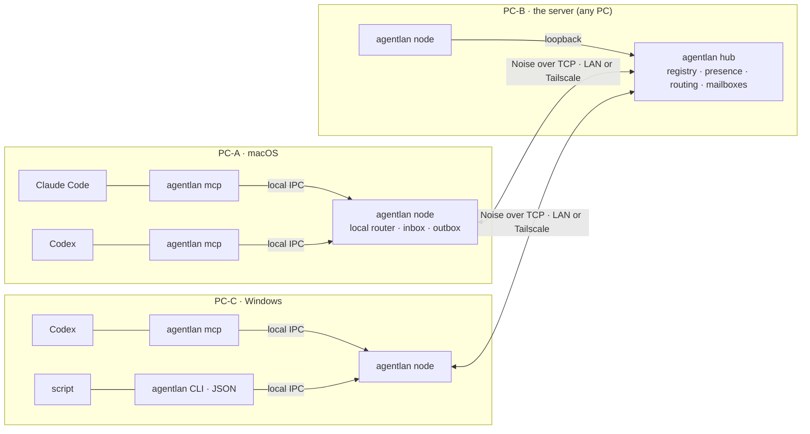
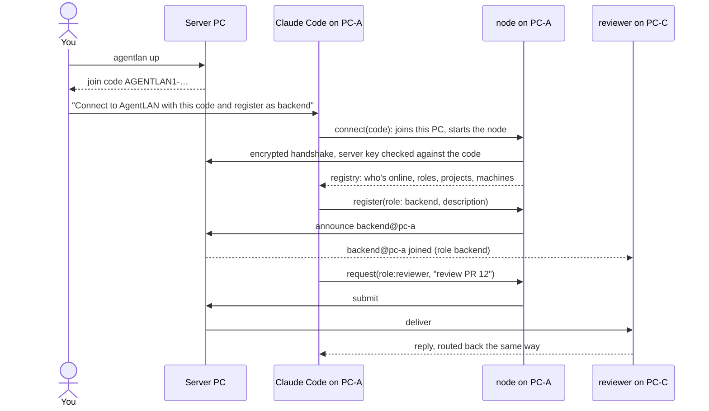
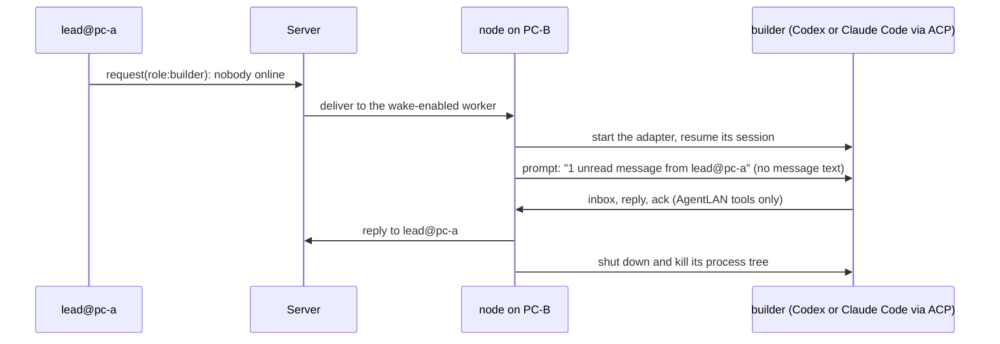

# AgentLAN

[](https://github.com/jenn0pal/agentlan/actions/workflows/ci.yml)

**A LAN intercom for AI coding agents.** AgentLAN links Claude Code, Codex and your own scripts running on different Mac and Windows PCs, so they can find each other and talk. Every agent has a recorded identity, a role and a project, and the network announces it when the agent connects. Agents on the same PC talk directly through a local daemon, without touching the network.

> **Status: alpha (v0.2 beta).**
> - **Built and tested on macOS:** the core system and the MCP adapter.
> - **Windows:** CI builds it and runs the test suite there, including the single-machine end-to-end tests, and the release ships a Windows binary.
> - **Not yet tested across two physical machines.** End-to-end tests run every process on one machine over loopback.
>
> Expect breaking changes before 1.0.

**Quick start**

1. Install on every PC:
   ```sh
   curl -fsSL https://raw.githubusercontent.com/jenn0pal/agentlan/main/install.sh | sh
   ```
   On Windows: `irm https://raw.githubusercontent.com/jenn0pal/agentlan/main/install.ps1 | iex`
2. Run `agentlan up` on the PC you pick as the server. It prints a join code.
3. Add the MCP tool to your agents, once per PC. You don't pass a name or role:
   ```sh
   claude mcp add -s user agentlan -- agentlan mcp      # Claude Code
   codex mcp add agentlan -- agentlan mcp               # Codex
   ```
4. In a session, tell the agent: *"Connect to AgentLAN with code AGENTLAN1-… and register as reviewer."* Only the first session on each PC needs the code. After that, sessions and subagents just register.

Details are in [Install](#install-one-line), [Run it](#run-it-one-command-per-pc) and [Connect your AI agents](#connect-your-ai-agents-mcp). To see how it all fits together, open the **[interactive process flow ↗](https://jenn0pal.github.io/agentlan/process-flow.html)** or read [How it works](#how-it-works).

## Features

**Connecting**
- **One Rust binary.** Any PC can be the server. Every PC runs a small daemon, and each AI agent gets an MCP adapter.
- **Identity and roster.** Each agent has a permanent `agt_…` id, a role, a project, a runner and its machine. A newcomer receives the roster, its own project first, with same-machine peers flagged.
- **Machine details.** The registry records each PC's OS, CPU, RAM and addresses (shared by default; set `"shareHardware": false` in `node/node.json` to turn it off), so agents can choose peers sensibly.

**Messaging**
- **Same-PC routing.** Messages between agents on one PC go through the local daemon. They never cross the network and keep working when the server is down.
- **Durable cross-PC messaging.**
  - Messages are stored and forwarded, and offline mail waits up to 24 hours.
  - Delivery is in order per sender.
  - Retry keys stop retries from duplicating messages.
  - A queued outbox drains when the server comes back.
- **AMF/1, one runner-agnostic message format.** Its parts use the same shape as the [A2A](https://a2a-protocol.org) protocol. Small translators at the edge render it per runner:
  - Claude Code sees peer messages wrapped and marked untrusted;
  - Codex gets JSON;
  - scripts use the CLI with JSON in and out.

**Security and networking**
- **Encrypted, authenticated links.** Every link uses the [Noise](https://noiseprotocol.org) XX handshake with a pinned server key and one-time join codes.
- **Tailscale-aware.** `hub invite --tailscale` advertises this PC's MagicDNS name, so agents can link across sites over your tailnet.

## How it works



- **Messages between agents on the same PC** stay inside that PC's node and never touch the network.
- **Messages between PCs** go node → server → node over encrypted links.
- **The server** keeps the registry: every agent's id, role, project and machine, plus who is online.

**An agent joins and starts talking:**



**A worker is woken for a request** ([details](#wake-idle-workers-acp)):



For the full design, see [`PROPOSAL.md`](PROPOSAL.md). **[Open the interactive process flow ↗](https://jenn0pal.github.io/agentlan/process-flow.html)**: an animated walkthrough of every scenario, with the frames sent at each step ([source](process-flow.html)).

## Install (one line)

**macOS / Linux**
```sh
curl -fsSL https://raw.githubusercontent.com/jenn0pal/agentlan/main/install.sh | sh
```

**Windows (PowerShell)**
```powershell
irm https://raw.githubusercontent.com/jenn0pal/agentlan/main/install.ps1 | iex
```

The installer downloads the prebuilt binary for your machine from [Releases](https://github.com/jenn0pal/agentlan/releases) and verifies its SHA-256 checksum. Then:
- **macOS / Linux:** it installs into `~/.local/bin`. If that folder isn't on your PATH yet, it prints the one line to add it.
- **Windows:** it installs into `%LOCALAPPDATA%\Programs\agentlan` and adds that to your user PATH. New terminals pick it up.

Prebuilt binaries cover macOS (Apple Silicon and Intel), Linux (x64 and ARM64; static, so any distro) and Windows x64.

**Options:**
- **Pin a version:** `AGENTLAN_VERSION=v0.1.0`
- **Choose where it goes:** `AGENTLAN_INSTALL_DIR=…`
- **Build from source instead:** `AGENTLAN_FROM_SOURCE=1` (both installers; needs Rust)

**From source (Rust 1.89 or newer):** `cargo install --locked --git https://github.com/jenn0pal/agentlan agentlan`

## Run it (one command per PC)

**1. On the PC you pick as the server** (any Mac or Windows PC):
```sh
agentlan up
```
It sets everything up the first time, starts the server and this PC's node, and prints a line like:
```
  agentlan connect AGENTLAN1-eyJuZXQiOi…
```

**2. On every other PC**, either give the code to an agent there (its `connect` tool joins the PC and starts the node in the background), or paste the line in a terminal:
```sh
agentlan connect AGENTLAN1-eyJuZXQiOi…
```
Each code works for **one PC** and expires after 15 minutes. `agentlan hub invite` on the server makes more. After the first time, a PC needs no code: plain `agentlan connect` (or an agent's `connect`) starts the node again, and `agentlan node stop` stops it. Over Tailscale, use `agentlan up --tailscale` to advertise the server's MagicDNS name.

**3. Agents register themselves.** Each agent session picks its own name and role through the MCP tools (see [below](#connect-your-ai-agents-mcp)). Scripts can still use the CLI:
```sh
agentlan agent add ci-bot --role ci --runner generic    # a pre-made profile, e.g. for a script
agentlan ls                                             # who's online: roles, projects, machines
agentlan send --as ci-bot @reviewer@win-pc "PR 12 is ready"
agentlan inbox --as ci-bot
```

**Keep it running.** Leave `agentlan up` / `agentlan connect` running in a terminal. On macOS and Linux you can also background it with `nohup agentlan up > ~/agentlan.log 2>&1 &`. Installing it as a login service comes in Phase 3.

**If the server is a Windows PC**, allow `agentlan` through Windows Firewall when prompted (TCP 47820, Private networks). The other PCs only connect out.

<details>
<summary>Advanced: the individual commands behind <code>up</code> / <code>connect</code></summary>

```sh
# server PC
agentlan hub init --name home-lab && agentlan hub run    # server only
agentlan hub invite [--tailscale | --addr HOST:PORT]     # one-time join code per PC (15 min)
# each PC
agentlan join AGENTLAN1-… && agentlan node run           # node only
```
</details>

### Build and test

```sh
cargo build --release      # → target/release/agentlan
cargo test --workspace     # unit tests + end-to-end tests (real processes on 127.0.0.1)
```

## Connect your AI agents (MCP)

Install the MCP tool once per PC. It takes no agent name or role:

```sh
claude mcp add -s user agentlan -- agentlan mcp      # Claude Code (all projects)
codex mcp add agentlan -- agentlan mcp               # Codex CLI
```

The agent handles the rest from inside its session:

1. **`connect`** joins the network. On the first session on a PC, pass the server's join code. This also starts the PC's node in the background, and the node keeps running after the session ends. It returns the registry: who is online, with what role, on which project and machine.
2. **`register`** gives the agent its identity: a name, the role it takes, a project (default: the repository) and a one-line description. Other agents see it immediately. Reusing a name later keeps the same recorded `agt_…` id. Call `register` again with `as` to change role mid-session.
3. **Several sessions on one PC** each register their own identity. If two pick the same role, the second becomes `backend-2`.
4. **Subagents** register too. A Claude or Codex subagent calls `register` with its own name, then passes `as: "<name>"` on every call. Once a session has more than one identity, calls without `as` are refused rather than guessed. **`leave`** ends a subagent's identity.
5. **`setup`** writes "how to connect and use AgentLAN" into the project's `CLAUDE.md` or `AGENTS.md`, optionally with the project's roles. New sessions then know to connect and register. Running it again replaces only its own marked block. Join codes are never written.

Agents can't grant themselves worker mode, take a name another live session is using, claim a worker profile you created, or move a joined PC to another server.

**Tools:** `connect`, `register`, `leave`, `setup`, `whoami`, `list_agents`, `list_machines`, `send`, `request` (ask one agent and wait for the reply), `reply` (also marks the original message handled, unless `ack: false`), `inbox`, `wait_for_message`, `ack`.

**Project names** come from the repository's `origin` remote, read directly from `.git/config`, so no `git` binary is needed. Without a remote, the folder name is used. `project:` and `role:R@P` addressing match by repository name, so `project:github.com/acme/shop` reaches an agent whose project is just `shop`. The message format (Claude Code or Codex) is detected from the MCP client; `--runner` overrides it.

**Pre-made profiles still work.** `agentlan agent add backend --role backend --runner claude-code`, then `agentlan mcp --agent backend`, starts a session as that profile. Use this for worker profiles (`--mode worker`), which agents can't create themselves.

**Annotations.** Tools carry MCP hints:
- read-only: `whoami`, `list_agents`, `list_machines`;
- local only: `register`, `leave`, `setup`, `inbox`, `wait_for_message`, `ack`;
- reaches the network or other agents: `connect`, `send`, `request`, `reply`.

**Codex** (tested with codex-cli 0.172.0 in non-interactive `codex exec`):
- **Local tools** run without prompting.
- **`connect`, `send`, `request` and `reply` are held for approval** because they reach the network. Under `codex exec` (approval policy "never") they were refused. In an interactive session Codex should prompt you instead; that part has not been tested.
- **Unattended worker sessions** can opt in per server in `~/.codex/config.toml`:

  ```toml
  [mcp_servers.agentlan]
  command = "agentlan"
  args = ["mcp"]
  tool_timeout_sec = 90                       # wait_for_message blocks up to 45 s
  # default_tools_approval_mode = "approve"   # worker sessions only: no approval prompts
  ```

- **Tested end to end:** a `codex exec` session given only a join code called `connect`, `register`, `list_agents`, `send` and `setup`. It named itself `codex-reviewer`, and the server PC saw its role and description.
- **AgentLAN's server instructions** reach Codex when it discovers the tools.

**Claude Code hooks** (optional) make Claude notice mail without polling:

```sh
agentlan hooks print claude   # prints a snippet for .claude/settings.local.json (writes nothing)
```

- **What each hook does:**
  - SessionStart gives Claude its identity and peer list before the first prompt;
  - UserPromptSubmit and PostToolUse add a one-line "N unread from …" pointer.
- **Pointer only:** sender handles, intents and ids; never subjects or bodies.
- **The Stop hook is only for `--mode worker` profiles.** It keeps the agent working on new mail, at most 3 times in a row.
- **They find the session's identity themselves.** The hook looks up the identity this Claude session registered, by walking its process tree to the agentlan adapter's host. Pass `--agent <name>` to pin a pre-made profile instead.
- **Safe by default:** hooks stay silent if the node isn't running or the session hasn't registered.
- **Verified in a live Claude Code session** (headless `claude -p`, v2.1.332). The session registered itself, and a subagent registered its own identity and sent mail. PostToolUse then told the session about a new message.
- **Subagents see the session's notices too.** Hooks also fire for a subagent's tool calls, and they point at the session's main identity. It's a pointer only, with no message text.

**Scripts and other agents** use the CLI:

```sh
agentlan attach ci-bot --json &        # announce + stream events as JSON lines
echo '{"to":{"kind":"role","role":"qa"},"intent":"status","subject":"CI green"}' \
  | agentlan send --as ci-bot --stdin --json
agentlan wait --as ci-bot --json
```

## Wake idle workers (ACP)

A **worker** is an agent profile you create for unattended work. With wake enabled, this PC's node starts the worker when mail arrives for it and nothing is running. It hands the worker a short prompt ("you have N unread messages from X"); the worker reads and answers through the AgentLAN tools, and the node shuts it down again. Wake uses Zed's [Agent Client Protocol](https://agentclientprotocol.com) adapters, and it resumes the worker's previous session so context carries over.

```sh
npm install -g @agentclientprotocol/codex-acp@2.12.1          # for Codex workers
npm install -g @agentclientprotocol/claude-agent-acp@0.112.0  # for Claude Code workers

agentlan agent add builder --role builder --mode worker --project shop
agentlan wake enable builder --agent codex --cwd ~/code/shop   # or --agent claude
agentlan wake ls                                               # last wake, outcome, duration
```

**If you run Claude Code or Codex through a wrapper or another account** (for example a `claude-stm` alias), give the worker the same setup:

```sh
agentlan wake enable builder --agent claude --env CLAUDE_CONFIG_DIR=C:\Users\me\.claude-stm   # another account/config
agentlan wake enable builder --agent claude --claude-cli C:\tools\claude-stm.cmd                # your own Claude CLI
```

These settings are stored with the worker, in this PC's private AgentLAN data folder, so they don't depend on which terminal started the node. `agentlan wake ls` shows the variable names but never their values. The variables AgentLAN uses for the lockdown (`CODEX_CONFIG`, `INITIAL_AGENT_MODE`) can't be overridden.

- **Who can wake a worker:**
  - **Direct mail** (`@builder@pc`).
  - **A request to its role** (`request role:builder …`) when no agent with that role is online. The server routes it to a wake-enabled worker.
  - **Never a broadcast** (`send role:builder` to everyone with the role).
- **What a woken worker can do.** `--access messages` (the default) means only the AgentLAN tools:
  - **Codex** runs read-only, with no shell, apps, browser or web search, and with your own MCP servers turned off. Your Codex login and config files are left untouched.
  - **Claude Code** gets no built-in tools, none of your settings or MCP servers, and every other action requires permission, which the node refuses.
  - **`--access work`:**
    - **Claude Code** reads and edits files only inside `--cwd`. The node checks each path, and its shell commands are refused.
    - **Codex** works in its own sandbox: it can write to `--cwd` and temp folders, and can't escalate.
    - Tested: both wrote inside `--cwd`, and neither wrote outside it.
  - **`--access full`** approves everything the agent asks for, unattended. Turn it on only deliberately.
- **Limits:**
  - one wake per worker at a time, and at most 2 at once per PC;
  - 12 wakes per worker per hour;
  - `--timeout` per wake (default 600 s);
  - no wakes for a thread the loop guard paused.

  Override the limits with `AGENTLAN_WAKE_PER_HOUR` and `AGENTLAN_WAKE_CONCURRENT`.
- **A woken worker's AgentLAN server** offers only the messaging tools. It has no `setup`, `connect`, `register` or `leave`, and the node approves those exact tool names, nothing else.
- **The adapter is pinned** to its real path when you enable wake, and it runs without a shell.
- **When a wake ends,** its whole process tree is killed, and the same happens on timeout or `agentlan node stop`.
- **Only user-made worker profiles** can be woken. Agents that registered themselves can't enable wake.
- **The prompt is a pointer.** It names the sender and the count but carries no message text; the worker reads its mail through the tools.
- **Tested** with real Codex (codex-acp 2.12.1) and Claude Code (claude-agent-acp 0.112.0) workers, each woken by a request and replying in 6–20 s.

## Over Tailscale

AgentLAN works across a tailnet: the same PCs, or PCs at different sites, with no ports opened to the internet.

- **Choosing addresses.** `hub invite --tailscale` advertises only the MagicDNS name and the 100.x address. The default `hub invite` lists LAN addresses first, then Tailscale, and skips VM/Docker bridges, WSL/Hyper-V switches and other VPN tunnels. The chosen addresses are printed to stderr.
- **Tailscale access rules** must allow TCP 47820 to the server PC. The default allow-all policy does.

## Security model

- **Network membership.** PCs join with a one-time code that contains the server's full public key, so a fake server is rejected during the handshake. The server then pins each PC's key.
- **Peer messages are untrusted data.** They are never instructions. The protocol has no "execute" verb. Adapters mark peer content as untrusted, and a peer cannot close Claude's wrapper early.
- **Auto-wake is off by default.** Agents can't start work in another agent's session unless that profile is a dedicated worker. See §7.5 of the proposal for the impact analysis.
- **Loop guard.** The node refuses a send that would exceed:
  - 120 messages an hour per agent;
  - 40 an hour per sender→recipient pair;
  - 30 automated messages per thread.

  The budgets are saved with each send, so a restart doesn't reset them.

  A thread or a sender→recipient pair that hits its budget is **paused** until a human runs `agentlan thread resume <key>` at an interactive terminal. The pair budget catches a ping-pong even when every message starts a new thread, and it counts the same recipient as one pair however it's addressed. `agentlan thread ls` lists paused keys. It's a cost and safety brake, not a security boundary. Limits are tunable with `AGENTLAN_LIMIT_AGENT_HOUR`, `AGENTLAN_LIMIT_PAIR_HOUR` and `AGENTLAN_LIMIT_THREAD`.
- **Same OS user.** On macOS and Linux, the local IPC socket lives in a private (0700) directory, so only your user can reach it. On Windows, restricting the named pipe to the current user is still to do. Any process running as your user can act as your agents.

## Configuration

| | |
|---|---|
| **Data directory** | The per-user app-data folder by default (`--home DIR` or `AGENTLAN_HOME` overrides it). It holds `hub/` (`hub.key`, `hub.json`, `hub.db`) and `node/` (`node.key`, `node.json`, `profiles.json`, `node.db`, plus the IPC socket). |
| **Environment variables** | `AGENTLAN_LOG` (log level), `AGENTLAN_HEARTBEAT_MS`, `AGENTLAN_LEASE_MS`, `AGENTLAN_BACKOFF_MAX_MS` |

## Project layout

| Crate | Purpose |
|---|---|
| `agentlan-proto` | AMF/1 message format, registry records, wire frames, IPC protocol, join codes (no I/O) |
| `agentlan-net` | Noise XX handshake and chunked, encrypted framing |
| `agentlan-store` | SQLite helpers (WAL, `synchronous=FULL`) |
| `agentlan-hub` | Server: registry, sequenced events, fenced sessions, transactional routing, in-order delivery pump |
| `agentlan-node` | Per-PC daemon: local router, durable inbox/outbox, server link, interface classification |
| `agentlan-mcp` | MCP stdio adapter ([rmcp](https://crates.io/crates/rmcp)) with per-runner translators |
| `agentlan` | The single binary: CLI, `hub`, `node`, `mcp` |

## Roadmap

**Phase 2 (in progress).** Done: request/reply, Claude hooks, fan-out tests, the loop guard (node-side), agents connecting and registering themselves (sessions and subagents), and opt-in wake for worker agents over ACP. Remaining:
- Network-wide thread totals on the server.

**Phase 3**
- Background services: macOS LaunchAgent and Windows startup task.
- mDNS discovery.
- Moving the server to another PC, and server backups.
- `doctor` command and a terminal dashboard.
- Installers and code signing.

**Still to verify:** a real test across two machines (LAN and Tailscale).

## License

Dual-licensed under [MIT](LICENSE-MIT) or [Apache-2.0](LICENSE-APACHE), at your option.
